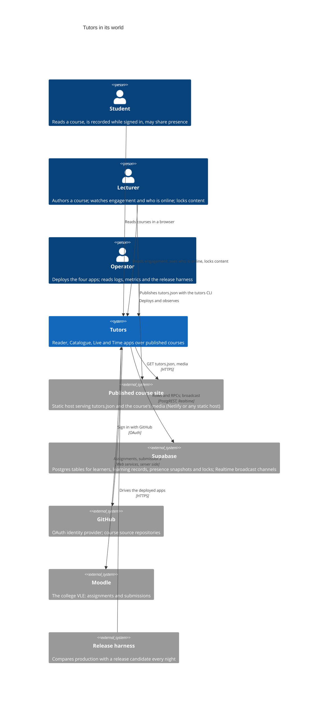
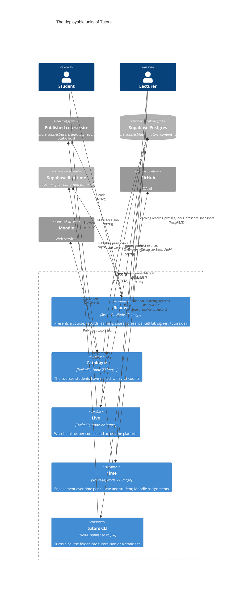
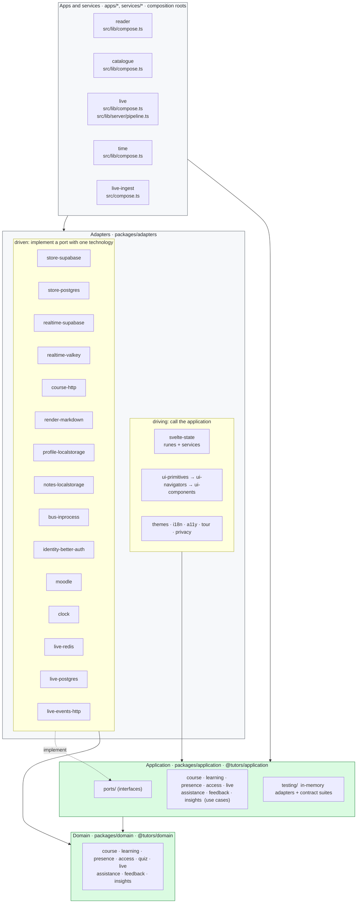
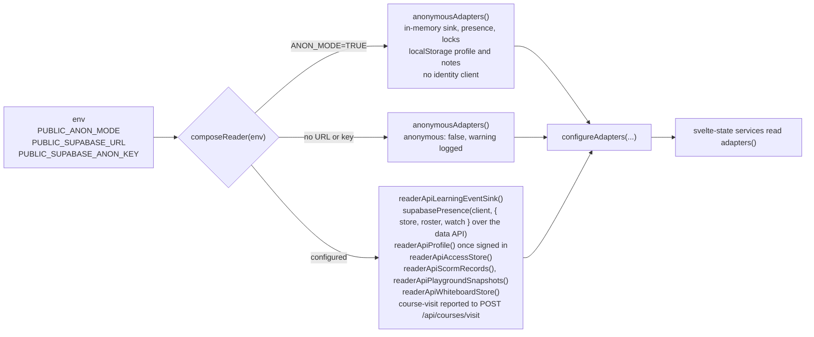
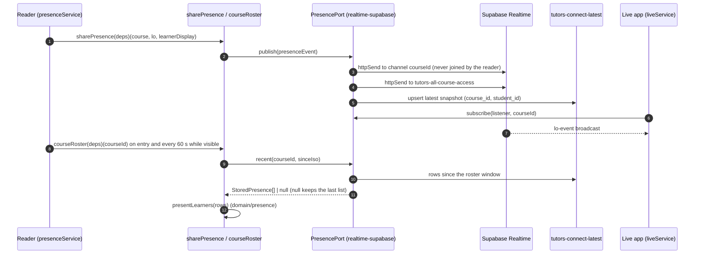
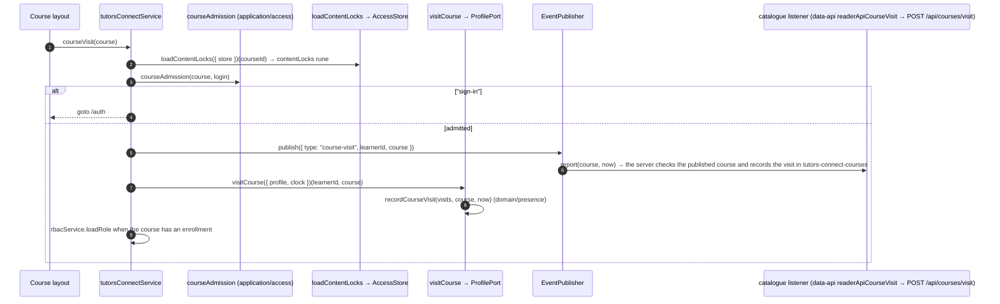
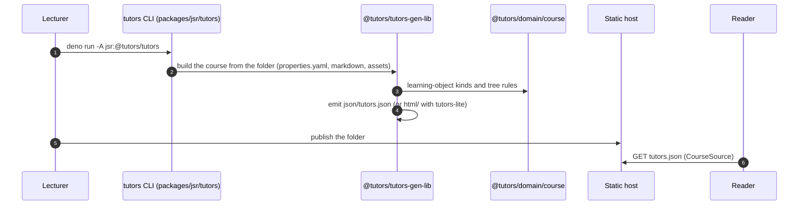

# Tutors Architecture

**This file is the authority on the shape of Tutors, the intent behind it and its ownership boundaries.** When code and this document disagree, one of them is wrong and the pull request that fixes it changes both. The structural statements in it are executable: Rules 0340 to 0352 in [`tests/bdd/features/developer/hexagonal-architecture.feature`](tests/bdd/features/developer/hexagonal-architecture.feature) check the repository against them on every pull request, and [`.dependency-cruiser.cjs`](.dependency-cruiser.cjs) enforces the dependency rules they state. The decision itself is recorded in [ADR 0001](docs/adr/0001-hexagonal-architecture.md).

Diagrams are Mermaid and render on GitHub. The C4 diagrams go from the system in its world (Context) to its deployable units (Containers) to the parts inside the reader (Components); the sequence diagrams show each core part doing its job through the rings.

## Contents

1. [Intent](#1-intent)
2. [System context (C4 level 1)](#2-system-context-c4-level-1)
3. [Containers (C4 level 2)](#3-containers-c4-level-2)
4. [The rings](#4-the-rings)
5. [Components of the reader (C4 level 3)](#5-components-of-the-reader-c4-level-3)
6. [The ports](#6-the-ports)
7. [The adapters](#7-the-adapters)
8. [Composition roots](#8-composition-roots)
9. [Core parts, each as a sequence](#9-core-parts-each-as-a-sequence)
10. [Ownership boundaries](#10-ownership-boundaries)
11. [Data ownership](#11-data-ownership)
12. [Dependency rules](#12-dependency-rules)
13. [Requirements (EARS)](#13-requirements-ears)
14. [Testing the architecture](#14-testing-the-architecture)
15. [Authoring toolchain and the JSR facades](#15-authoring-toolchain-and-the-jsr-facades)
16. [Deployment](#16-deployment)
17. [How to change things](#17-how-to-change-things)
18. [Glossary](#18-glossary)

---

## 1. Intent

Tutors is an open learning platform: a lecturer writes a course as a folder of markdown, the generator turns it into `tutors.json`, and the reader presents it to students, recording what they read, showing who else is present and letting a lecturer see engagement over time. The platform runs on Supabase (Postgres, Realtime), signs students in with GitHub through Better Auth, renders markdown with markdown-it, Shiki and KaTeX, and reads assignments from Moodle.

The architecture is **hexagonal** (ports and adapters). The rules of a course, of learning records, of presence and of access live in a **domain** ring that imports nothing. The **application** ring says what the product needs from the outside world as **ports** (interfaces) and holds the **use cases** that drive the domain through them. Everything that touches a technology is an **adapter** around those two rings: Supabase, Better Auth, markdown, localStorage, Moodle, the Svelte state and the UI. Each **app** is a composition root that reads its environment once and decides which adapter sits behind each port.

The intent is not to replace any technology. Supabase, Better Auth and the markdown toolchain stay. The intent is that:

- every rule of the product can be tested without a database, a browser or a network, through the in-memory adapters that ship with the application ring;
- each technology has exactly one home, so a dependency bump, a vendor advisory or a change in how a technology is used is made in one package;
- the anonymous reader (`PUBLIC_ANON_MODE=TRUE`) is the same product composed with different adapters, not a second code path;
- the shape is enforced, not described: a pull request that crosses a ring fails before review.

---

## 2. System context (C4 level 1)



**Boundary of the system.** Tutors owns the four apps and the packages in this repository. It does not own the course content (the lecturer's repository and static host), the identity (GitHub), the store (Supabase's service) or the VLE. Everything it does not own is reached through a port, and every port has an in-memory adapter.

---

## 3. Containers (C4 level 2)



Each app is a SvelteKit application built into a Node 22 container image on quay.io/tutors-sdk (signed with cosign, with an SBOM) and deployed from the kustomize overlays under `deploy/k8s`. The CLI is a Deno program published to JSR. The four apps share one Supabase project.

---

## 4. The rings



| Ring             | Directory                     | Package                                                                                                                                                                                                               | May import                                                              | Owns                                                                                                                                                                                                                                                                                                                                                                                                                                                                                                                                                                             |
| ---------------- | ----------------------------- | --------------------------------------------------------------------------------------------------------------------------------------------------------------------------------------------------------------------- | ----------------------------------------------------------------------- | -------------------------------------------------------------------------------------------------------------------------------------------------------------------------------------------------------------------------------------------------------------------------------------------------------------------------------------------------------------------------------------------------------------------------------------------------------------------------------------------------------------------------------------------------------------------------------- |
| Domain           | `packages/domain`             | `@tutors/domain` (`/course`, `/course/playground`, `/learning`, `/presence`, `/access`, `/quiz`, `/live`, `/assistance`, `/feedback`, `/insights`)                                                                    | Nothing outside itself                                                  | The course tree and its vocabulary (including the playground and SCORM learning objects and the playground workspace rules), learning events and records, the lab step reference, attempts, evidence and private notes, help requests and their state table, lecturer annotations and shared reflections, the insights aggregations, presence rules and the roster, admission, roles and locks, quiz parsing and scoring, and Tutors Live's event contract, session token, presence window and the arithmetic behind its stats, heat maps, activity tables and observation cards |
| Application      | `packages/application`        | `@tutors/application` (`/ports`, `/testing`)                                                                                                                                                                          | The domain                                                              | The thirty-five ports, the use cases, the in-memory adapters and the contract suite each adapter of a port must pass                                                                                                                                                                                                                                                                                                                                                                                                                                                             |
| Driven adapters  | `packages/adapters/driven/*`  | `@tutors/<name>`                                                                                                                                                                                                      | Ports, domain, one technology, `@tutors/logger`                         | One technology each, behind a port                                                                                                                                                                                                                                                                                                                                                                                                                                                                                                                                               |
| Driving adapters | `packages/adapters/driving/*` | `@tutors/<name>`                                                                                                                                                                                                      | Ports, domain, `svelte-state`, `@tutors/logger`                         | The Svelte state (the only home of runes), the UI, themes, i18n, a11y, tours, consent                                                                                                                                                                                                                                                                                                                                                                                                                                                                                            |
| Apps             | `apps/*`                      | `tutors-reader`, `tutors-catalogue`, `tutors-live`, `tutors-time`                                                                                                                                                     | Everything; never another app or service                                | Composition, routes, server hooks, environment                                                                                                                                                                                                                                                                                                                                                                                                                                                                                                                                   |
| Services         | `services/*`                  | `@tutors/live-ingest`                                                                                                                                                                                                 | Everything; never an app or another service                             | Long-running processes that are not SvelteKit apps, each with its own composition root (`src/compose.ts`) and image: today the Tutors Live ingest consumer, which runs the `createIngestor` use case against the Redis bus, Valkey and TimescaleDB adapters                                                                                                                                                                                                                                                                                                                      |
| Platform         | `packages/platform/*`         | `@tutors/logger`, `@tutors/metrics`, `@tutors/app-config`                                                                                                                                                             | Nothing in the rings                                                    | Logging, metrics, build configuration; used by every ring that runs on a server                                                                                                                                                                                                                                                                                                                                                                                                                                                                                                  |
| JSR              | `packages/jsr/*`              | `@tutors/tutors-model-lib`, `@tutors/tutors-time-lib`, `@tutors/tutors-types`, `@tutors/identity`, `@tutors/tutors-gen-lib`, `@tutors/tutors`, `@tutors/tutors-lite`, `@tutors/tutors-create`, `@tutors/tutors-scorm` | The facades import the rings; the authoring toolchain is self-contained | Published packages: facades over the domain for one major, and the authoring toolchain                                                                                                                                                                                                                                                                                                                                                                                                                                                                                           |

---

## 5. Components of the reader (C4 level 3)

```mermaid
C4Component
  title Inside the reader container

  Container_Boundary(reader, "Reader") {
    Component(routes, "Routes", "SvelteKit +page / +layout", "course, topic, lab, note, talk, video, quiz, wall, search, time, whiteboard, auth, create")
    Component(hooks, "hooks.server.ts", "SvelteKit", "Composes the adapters; request log, metrics, locale, security headers, identity handle")
    Component(compose, "compose.ts", "Composition root", "Reads PUBLIC_ANON_MODE and the Supabase env once; picks the adapter behind each port")

    Component(uiComponents, "ui-components", "Svelte", "Learning-object views, cards, time views")
    Component(uiNavigators, "ui-navigators", "Svelte", "Shell, navigators, footer")
    Component(uiPrimitives, "ui-primitives", "Svelte", "Icon, Image, Menu, Sidebar, toasts")
    Component(crossCutting, "themes · i18n · a11y · tour · privacy", "Svelte", "Theme, locale, reduced motion, tours, consent")

    Component(svelteState, "svelte-state", "Svelte 5 runes", "currentCourse, currentLo, tutorsId; courseService, analyticsService, presenceService, liveService, tutorsConnectService, rbacService, markdownService")
    Component(application, "@tutors/application", "TypeScript", "loadCourse, recordLearningEvent, recordHeartbeat, sharePresence, courseRoster, visitCourse, courseAdmission, loadContentLocks, shareSnippet, broadcastToCourse, isCourseEducator")
    Component(domain, "@tutors/domain", "TypeScript", "course tree, learning events, presence rules, access rules, quiz")

    Component(courseHttp, "course-http", "CourseSource", "GET tutors.json")
    Component(renderMarkdown, "render-markdown", "ContentRenderer", "markdown-it, Shiki, KaTeX")
    Component(storeSupabase, "store-supabase", "LearningEventSink, ProfilePort, AccessStore, LearningRecords, SnippetStore, catalogue", "PostgREST")
    Component(storePostgres, "store-postgres", "The same ports as store-supabase, and AssistanceStore", "pg, when DATA_STORE=postgres")
    Component(realtimeSupabase, "realtime-supabase", "PresencePort, CourseNotices", "Broadcast channels + tutors-connect-latest")
    Component(realtimeValkey, "realtime-valkey", "PresencePort, CourseNotices, PlaygroundLive, AssistanceFeed", "Server-sent events from the servers, Valkey pub/sub, when PUBLIC_REALTIME=valkey")
    Component(profileLocal, "profile-localstorage", "ProfilePort", "Browser localStorage")
    Component(notesLocal, "notes-localstorage", "NotesStore", "Browser localStorage; a learner's private notes, never sent anywhere")
    Component(busInprocess, "bus-inprocess", "EventPublisher", "In-process listeners")
    Component(identityAdapter, "identity-better-auth", "SessionPort, IdentityClient", "Better Auth, GitHub")
    Component(clockAdapter, "clock", "Clock", "HARNESS_NOW")
  }

  System_Ext(courseSite, "Published course site")
  ContainerDb_Ext(postgres, "Supabase Postgres")
  Container_Ext(realtime, "Supabase Realtime")
  System_Ext(github, "GitHub")

  Rel(hooks, compose, "configureAdapters(composeReader(env))")
  Rel(routes, uiComponents, "renders")
  Rel(uiComponents, uiNavigators, "")
  Rel(uiNavigators, uiPrimitives, "")
  Rel(routes, svelteState, "courseService.readCourse, analyticsService, presenceService")
  Rel(uiComponents, svelteState, "reads runes")
  Rel(crossCutting, svelteState, "reads runes")
  Rel(svelteState, application, "calls use cases with adapters()")
  Rel(application, domain, "")
  Rel(compose, courseHttp, "composes")
  Rel(compose, renderMarkdown, "composes")
  Rel(compose, storeSupabase, "composes")
  Rel(compose, realtimeSupabase, "composes")
  Rel(compose, realtimeValkey, "composes, when PUBLIC_REALTIME=valkey")
  Rel(compose, profileLocal, "composes")
  Rel(compose, notesLocal, "composes")
  Rel(compose, busInprocess, "composes")
  Rel(hooks, identityAdapter, "createIdentityHandle")
  Rel(compose, clockAdapter, "composes")
  Rel(courseHttp, courseSite, "HTTPS")
  Rel(storeSupabase, postgres, "PostgREST")
  Rel(realtimeSupabase, realtime, "httpSend; subscribe")
  Rel(realtimeSupabase, postgres, "tutors-connect-latest")
  Rel(identityAdapter, github, "OAuth")
```



The other three apps are smaller instances of the same shape: Live composes `realtime-supabase` (or `realtime-valkey` when `PUBLIC_REALTIME=valkey`) behind `PresencePort` and subscribes, reading the roster through `data-api`, and on Valkey streams a course's help queue from the reader (`AssistanceFeed`); Catalogue composes `data-api` for the course list; Time composes `data-api` for its error transport, `store-supabase` or `store-postgres` (as `DATA_STORE` picks) on its server for the health check and the snippets page, the time library's read model for calendar and lab analytics, and `moodle` on the server behind `AssignmentSource`.

---

## 6. The ports

A port is an interface in `packages/application/src/ports/`. It is named for what the application needs, not for the technology that provides it. Every port has an in-memory adapter in `@tutors/application/testing`, and the ones with behaviour worth contracting have a contract suite there that every adapter of the port runs.

```mermaid
classDiagram
  direction LR
  class CourseSource {
    +load(location, fetchFn?) Promise~string~
  }
  class CourseEmitter {
    +emit(course, destination) Promise~void~
  }
  class ContentRenderer {
    +renderLo(course, lo, protocol?)
    +renderSummary(lo)
    +renderMarkdown(md) string
    +mayContainMath(text) boolean
    +loadMath() Promise~void~
  }
  class LearningEventSink {
    +record(event, learnerId) Promise~void~
  }
  class LearningRecords {
    +calendarEntries(courseId, start?, end?)
    +learningRecords(courseId, learnerId?)
    +learners(courseId)
    +timeRows(courseId, start?, end?) Promise~TutorsTimeRows~
  }
  class CourseFactsSource {
    +lookup(courseId) Promise~CourseLookup~
  }
  class WhiteboardStore {
    +load(room, owner) Promise~WhiteboardScene | null~
    +save(room, owner, elements) Promise~boolean~
  }
  class PresencePort {
    +publish(event) Promise~void~
    +subscribe(listener, courseId?) Unsubscribe
    +recent(courseId, sinceIso) Promise~StoredPresence[] | null~
  }
  class ProfilePort {
    +getCourseVisits(learnerId)
    +saveCourseVisits(learnerId, visits)
    +upsertLearner(profile)
    +getSentiment(learnerId) / setSentiment
    +getSharing(learnerId) / setSharing
  }
  class SessionPort {
    +getActor() Promise~Actor | null~
  }
  class IdentityClient {
    +signIn(returnTo)
    +signOut(returnTo)
  }
  class AccessStore {
    +locks(courseId) Promise~ContentLock[]~
    +setLock(courseId, loRoute, locked, lockedBy) Promise~boolean~
    +removeLock(courseId, loRoute) Promise~boolean~
  }
  class EventPublisher {
    +publish(event: AppEvent) Promise~void~
    +subscribe(listener) Unsubscribe
  }
  class Clock {
    +now() Date
    +nowMs() number
  }
  class AssignmentSource {
    +courseContents(courseId, options?)
    +assignmentSubmissions(assignmentIds, options?)
  }
  class LiveBus {
    +publish(events) Promise~void~
    +subscribe(handler) Promise~unsubscribe~
  }
  class LivePresenceStore {
    +touch(event) Promise~void~
    +now(at?) Promise~NowSnapshot~
  }
  class LiveWarehouse {
    +append(events) / upsertSession(row) / purgeUid(uid)
    +hourly(range) / hourlySessions(range) / sessions(range)
    +courses(range) / topLos(range, limit)
  }
  class LiveEventReporter {
    +courseOpened(course) / loViewed(course, lo, loType) / serviceUsed(course, service)
    +identify(uid?) / start(course, lo) stop
    +flush() / flushBeacon()
  }
  class AssistanceStore {
    +open(request) Promise~HelpRequest~
    +get(id) / live(courseId) / latest(courseId, learnerId)
    +replace(next, from) Promise~boolean~
  }
  class AssistanceFeed {
    +publish(change) Promise~boolean~
    +watch(courseId, listener) Unsubscribe
  }
  class FeedbackStore {
    +annotate(annotation) / get(id) / forStep(ref) / received(courseId, learnerId) / revoke(id, at)
    +reflect(reflection) / reflections(courseId, learnerId) / reflectionsAt(ref)
  }
  class NotesStore {
    +get(ref) / put(note) / remove(ref)
    +forCourse(courseId) Promise~Note[]~
  }
  class InsightsRead {
    +helpRequests(courseId, period)
    +annotations(courseId, period) / reflections(courseId, period)
  }
  class InsightsDesk {
    +course(courseId, span, day)
    +student(courseId, learnerId, span, day)
  }
```



| Port                  | What the application needs                                                                                                                                                                               | Driven adapters                                                                                                                                                                                                                                                    | In-memory adapter             | Contract suite                |
| --------------------- | -------------------------------------------------------------------------------------------------------------------------------------------------------------------------------------------------------- | ------------------------------------------------------------------------------------------------------------------------------------------------------------------------------------------------------------------------------------------------------------------ | ----------------------------- | ----------------------------- |
| `CourseSource`        | The text of a published `tutors.json`                                                                                                                                                                    | `course-http`                                                                                                                                                                                                                                                      | `InMemoryCourseSource`        | —                             |
| `CourseEmitter`       | Write a built course out                                                                                                                                                                                 | (the generator's own emitter, until authoring is extracted)                                                                                                                                                                                                        | `InMemoryCourseEmitter`       | —                             |
| `ContentRenderer`     | Markdown to HTML, maths on demand                                                                                                                                                                        | `render-markdown`                                                                                                                                                                                                                                                  | `PassThroughRenderer`         | —                             |
| `LearningEventSink`   | Record a page load or a 30-second tick for a learner                                                                                                                                                     | `store-supabase` (on the reader's server), `data-api` (in the browser, over `POST /api/analytics`); `store-postgres` in its place when `DATA_STORE=postgres`                                                                                                       | `InMemoryLearningEventSink`   | `learningEventSinkContract`   |
| `LearningRecords`     | Read what was recorded about a course; `timeRows` is everything Tutors Time needs in one answer                                                                                                          | `store-supabase`; `store-postgres` in its place when `DATA_STORE=postgres`                                                                                                                                                                                         | `InMemoryLearningRecords`     | —                             |
| `CourseFactsSource`   | The facts of a published course that authorisation needs (educators, privacy, credits)                                                                                                                   | `course-http` (`httpCourseFacts`)                                                                                                                                                                                                                                  | `InMemoryCourseFacts`         | —                             |
| `WhiteboardStore`     | A whiteboard scene for a shared room or a learner's personal room                                                                                                                                        | `store-supabase` (server), `data-api` (browser, over `/api/whiteboard`); `store-postgres` in its place when `DATA_STORE=postgres`                                                                                                                                  | `InMemoryWhiteboardStore`     | —                             |
| `PresencePort`        | Share where a learner is; watch a course; read who was active since                                                                                                                                      | `realtime-supabase` (channels), reading the roster over `GET /api/presence/roster`; `realtime-valkey` (server-sent events) in its place when `PUBLIC_REALTIME=valkey`                                                                                              | `InMemoryPresence`            | `presenceContract`            |
| `ProfilePort`         | A learner's visit history, sentiment and sharing                                                                                                                                                         | `store-supabase` (server), `data-api` (browser, signed in), `profile-localstorage` (not signed in); `store-postgres` in its place when `DATA_STORE=postgres`                                                                                                       | `InMemoryProfile`             | `profileContract`             |
| `SessionPort`         | The verified actor of a request                                                                                                                                                                          | `identity-better-auth/server`                                                                                                                                                                                                                                      | `FixedSession`                | —                             |
| `IdentityClient`      | Sign in and out from the browser                                                                                                                                                                         | `identity-better-auth/client`                                                                                                                                                                                                                                      | `RecordingIdentityClient`     | —                             |
| `AccessStore`         | The content locks lecturers set                                                                                                                                                                          | `store-supabase` (server), `data-api` (browser, over `GET`, `PUT` and `DELETE /api/locks`); `store-postgres` in its place when `DATA_STORE=postgres`                                                                                                               | `InMemoryAccessStore`         | `accessStoreContract`         |
| `EventPublisher`      | Tell the rest of the application something happened                                                                                                                                                      | `bus-inprocess`                                                                                                                                                                                                                                                    | `RecordingPublisher`          | `eventPublisherContract`      |
| `Clock`               | The instant, so time can be frozen                                                                                                                                                                       | `clock`                                                                                                                                                                                                                                                            | `FixedClock`                  | —                             |
| `AssignmentSource`    | Assignments and submissions from the VLE                                                                                                                                                                 | `moodle`                                                                                                                                                                                                                                                           | `InMemoryAssignmentSource`    | —                             |
| `CodeRuntimePort`     | Open a run-time for student code (`CodeRuntime`): a Python, JavaScript or TypeScript engine that never runs on the reader's own origin                                                                   | `runtime-wasm`                                                                                                                                                                                                                                                     | `ScriptedCodeRuntimePort`     | —                             |
| `CodeRuntime`         | One opened run-time: start, execute a workspace, stream its output, stop, restart, dispose                                                                                                               | `runtime-wasm` (the `Kernel`)                                                                                                                                                                                                                                      | `ScriptedCodeRuntime`         | `codeRuntimeContract`         |
| `WorkspaceStore`      | Keep a student's playground edits between visits, with no account                                                                                                                                        | `workspace-indexeddb`                                                                                                                                                                                                                                              | `InMemoryWorkspaceStore`      | `workspaceStoreContract`      |
| `ScormRecords`        | Each learner's SCORM run-time state, so an imported package resumes anywhere                                                                                                                             | `store-supabase` (server), `data-api` (browser, over `GET` and `PUT /api/scorm`); `store-postgres` in its place when `DATA_STORE=postgres`                                                                                                                         | `InMemoryScormRecords`        | `scormRecordsContract`        |
| `PlaygroundSnapshots` | A student's workspace handed to the lecturer, and whether this deployment can attribute it                                                                                                               | `data-api` (browser, over `/api/playground`; the server keeps the rows with `store-supabase`); `store-postgres` in its place when `DATA_STORE=postgres`                                                                                                            | `InMemoryPlaygroundSnapshots` | `playgroundSnapshotsContract` |
| `PlaygroundLive`      | A student sharing a playground as it is typed, and a lecturer watching                                                                                                                                   | `realtime-supabase`; `realtime-valkey` in its place when `PUBLIC_REALTIME=valkey`                                                                                                                                                                                  | `InMemoryPlaygroundLive`      | `playgroundLiveContract`      |
| `SnippetStore`        | Keep a learner's shared snippet for the course's educators; read the ones not yet expired; count a learner's recent shares                                                                               | `store-supabase` (servers, service key), `course-http` (`httpSnippetStore`, the browser: posts to the reader's server); `store-postgres` in its place when `DATA_STORE=postgres`                                                                                   | `InMemorySnippetStore`        | `snippetStoreContract`        |
| `CourseNotices`       | Post a course notice (a content-free "snippet shared" ping, a lecturer's broadcast) and watch for them                                                                                                   | `realtime-supabase` (`supabaseCourseNotices` in the browser, `publishCourseNotice` on the server); `realtime-valkey` in its place when `PUBLIC_REALTIME=valkey` (`valkeyCourseNotices`, `publishNotice`)                                                           | `InMemoryCourseNotices`       | `courseNoticesContract`       |
| `LiveBus`             | Carry `tutors.live.*` events from the ingest endpoint to whatever consumes them                                                                                                                          | `live-redis` (Redis Streams)                                                                                                                                                                                                                                       | `inMemoryLiveBus`             | —                             |
| `LivePresenceStore`   | Who is reading this minute: the dashboard's Now layer                                                                                                                                                    | `live-redis` (Valkey sorted sets)                                                                                                                                                                                                                                  | `inMemoryPresenceStore`       | —                             |
| `LiveWarehouse`       | Raw live events and sessions in, hourly rollups and session rows out; `ActivityRead` is its read half, `ActivityWrite` its write half                                                                    | `live-postgres` (TimescaleDB)                                                                                                                                                                                                                                      | `inMemoryWarehouse`           | —                             |
| `ActivityRead`        | The rollups the read model computes stats, heat maps, activity and observations from                                                                                                                     | `live-postgres`                                                                                                                                                                                                                                                    | `inMemoryWarehouse`           | —                             |
| `ActivityWrite`       | What the ingest use case appends                                                                                                                                                                         | `live-postgres`                                                                                                                                                                                                                                                    | `inMemoryWarehouse`           | —                             |
| `LiveEventReporter`   | Tell Tutors Live what this reader session is doing, with a rotating token and no login                                                                                                                   | `live-events-http`                                                                                                                                                                                                                                                 | `RecordingLiveEventReporter`  | —                             |
| `AssistanceStore`     | Open help requests, read one, a course's live ones or a learner's latest, and move one with a compare-and-set on its state, kind, step and rating as read                                                | `store-postgres` (`postgresAssistanceStore`, `assistance_requests`; the reader's server only, behind `/api/assistance`, when `DATA_STORE=postgres`; no Supabase adapter)                                                                                           | `InMemoryAssistanceStore`     | `assistanceStoreContract`     |
| `AssistanceFeed`      | Tell the lecturers watching a course that a help request or an annotation changed                                                                                                                        | `realtime-valkey` (`valkeyAssistanceFeed` on the reader's server; `sseAssistanceFeed` in Tutors Live, streaming `assistance:<courseId>` from the reader with the session), when `PUBLIC_REALTIME=valkey`                                                           | `InMemoryAssistanceFeed`      | `assistanceFeedContract`      |
| `HelpDesk`            | What a page asks of help requests as the person signed in: ask, withdraw, mark solved and rate; read the queue, acknowledge, answer a hint, resolve                                                      | `data-api` (`readerApiHelpDesk`: the reader's `/api/assistance`, with the session from Tutors Live)                                                                                                                                                                | `InMemoryHelpDesk`            | `helpDeskContract`            |
| `FeedbackStore`       | Keep lecturers' annotations and the reflections students share; read a step's annotations, what a learner received and a step's reflections; revoke an annotation, keeping it                            | `store-postgres` (`postgresFeedbackStore`, `feedback_annotations` and `feedback_reflections`; the reader's server only, behind `/api/feedback`, when `DATA_STORE=postgres`; no Supabase adapter)                                                                   | `InMemoryFeedbackStore`       | `feedbackStoreContract`       |
| `FeedbackDesk`        | What a page asks of lecturer feedback as the person signed in: a step's feedback (and, for an educator, its history), what a student received, annotate, broadcast, revoke, share a note as a reflection | `data-api` (`readerApiFeedbackDesk`: the reader's `/api/feedback`, with the session from Tutors Live and Tutors Time)                                                                                                                                              | `InMemoryFeedbackDesk`        | `feedbackDeskContract`        |
| `NotesStore`          | A learner's private note per lab step, and a course's notes for export; never sent to a server                                                                                                           | `notes-localstorage` (the browser, in every mode)                                                                                                                                                                                                                  | `InMemoryNotesStore`          | `notesStoreContract`          |
| `InsightsRead`        | Read a course's stored help requests, annotations and reflections over a bounded period, with no write method                                                                                            | `store-postgres` (`postgresInsightsRead`, over the views `insights_help_requests`, `insights_annotations` and `insights_reflections`, which carry no free text; the reader's server only, behind `/api/insights`, when `DATA_STORE=postgres`; no Supabase adapter) | `InMemoryInsightsRead`        | `insightsReadContract`        |
| `InsightsDesk`        | What Tutors Time asks of insights as the educator signed in: a course's steps ranked by the help they needed, its help response times and cohort over a day, week or month, and one student's part       | `data-api` (`readerApiInsightsDesk`: the reader's `GET /api/insights`, with the session from Tutors Time)                                                                                                                                                          | `InMemoryInsightsDesk`        | `insightsDeskContract`        |

The application also owns **authorisation** (`packages/application/src/access/authorization.ts`): `createAuthorization({ courseFacts, clock, admins })` answers `can(actor, action, resource)` from the course's published facts (cached, with a stale fallback and an `AuthorizationUnavailableError` when the course host cannot be reached) and the domain's roles; the reader's server routes ask it before every write. `loadTimeRows` (`learning/time-rows.ts`) is the use case behind `GET /api/time/:courseId`: an educator gets the rows, a student gets them pseudonymised (`pseudonymise` in the domain).

Application events (`AppEvent`) are `learning` (a learner's page load or tick), `presence` (a sharing learner moved), `course-visit` (a learner opened a course; the catalogue counts it), `evidence-recorded` (a learner left evidence at a step: the step and the kind, never the content), `help-requested` (a student asked, or asked again), `help-answered` (a lecturer answered with a hint or resolved a request) and `feedback-posted` (an educator posted an annotation or a broadcast). They are how one part of the product reacts to another without importing it.

The learning, assistance, feedback and insights contexts (Rules 0375 to 0389, 0400 to 0402, 0410 to 0419, 0571) follow the same shape: the rules in `@tutors/domain/learning` (the `StepRef` every record carries, `attemptsFromRecords`, evidence, `noteKey` and `notesToMarkdown`), `@tutors/domain/assistance` (the help-request state table, `rateHelp`, `waitingMs`, `shouldEscalate`, `shouldExpire`, `queueOrder`), `@tutors/domain/feedback` (anchors, audiences, reflections) and `@tutors/domain/insights` (step diagnostics, student progress, response times), and the use cases in `@tutors/application` (`saveNote`, `openStepNotes`, `exportNotes`, `withMemoryFallback`, `recordEvidence`; `requestHelp`, `acknowledgeHelp`, `answerHint`, `resolveHelp`, `withdrawHelp`, `rateHelp`, `helpQueue`, `myHelpRequest`; `annotate`, `broadcast`, `revokeAnnotation`, `stepFeedback`, `stepHistory`, `receivedFeedback`, `shareReflection`; `stepDiagnostics`, `studentProgress`, `helpResponseTimes`, `courseInsights`, `educatorInsights`). The four contexts import none of each other's use cases; they share the Learning context's types and react through application events. Private notes are kept by `notes-localstorage`, the reader's browser storage, and nothing else (decision D1, Rules 0380 to 0383); the reader's notes panel is `notesService` in `svelte-state` and `NotesPanel` on the lab step (Rules 0554 to 0558). Help requests are kept by `store-postgres` (`assistance_requests`, one live request per learner and course by a partial unique index) and their changes travel on `realtime-valkey`'s `assistance:<courseId>` topic; the reader's server runs the use cases as the session's actor behind `POST /api/assistance`, answers the queue (`GET /api/assistance`, educators only) and a student's own request (`GET /api/assistance/mine`), and streams the topic only to a signed-in educator of the course (Rules 0390, 0391, 0392 and 0394). No Supabase table or channel backs them. Pages reach them through the `HelpDesk` port (`readerApiHelpDesk` over those routes): the reader's lab step carries `HelpButton` and `HelpNotice` over `helpService` (a signed-in student asks, sees the waiting time, withdraws or marks it solved, reads a lecturer's typed hint on the step and says once whether the help helped, which is kept as `helped` on the request; hidden from visitors and in anonymous mode; Rules 0397, 0398 and 0399), and Tutors Live's course page carries `HelpQueue` over `helpQueueService` (the queue read every 60 seconds and patched from the stream between reads, with the student, lab and step, kind, waiting time each second and presence, lecturer requests first; Rules 0393, 0395 and 0396). Lecturer feedback (Rules 0400 to 0409, 0564 to 0570) is kept by `store-postgres` (`feedback_annotations`, `feedback_reflections`); the reader's server runs the use cases as the session's actor behind `/api/feedback` (a step's broadcasts and the student's own annotations from one read, the step's history and reflections for an educator of the course; annotate, broadcast, revoke, reflect) and `/api/feedback/mine` (what a student received, newest first), refusing a reader a private course does not admit (`courseAccessOf`, `courseAdmission`; Rule 0567). A broadcast is also one `annotation` change on `assistance:<courseId>` for Tutors Live and one `course:broadcast` notice toasted to the course's students, naming the step without the explanation's text and at most one a minute per course, the limit lecturer broadcasts share. Pages reach it through the `FeedbackDesk` port (`readerApiFeedbackDesk`): the reader's lab step carries `FeedbackBanner`, `FeedbackCards` and, for an educator, `FeedbackComposer` over `feedbackService` (read when the step opens and every 60 seconds while visible, no realtime channel), and `NotesPanel` shares a note as a reflection and lists what the student received; Tutors Live's `HelpQueue` offers a resolved request as an explanation for everyone on its step (Rule 0407), the only link from Assistance to Feedback; Tutors Time's snippets page sends feedback on a snippet to the step it was shared from. Insights (Rules 0410 to 0419, 0571) write nothing: `store-postgres`'s `postgresInsightsRead` reads three views of the assistance and feedback tables that carry no free text (`insights_help_requests`, `insights_annotations`, `insights_reflections`), each read naming the course and a half-open period over an index that leads with both (Rule 0417), and answers `InsightsNotReadyError` when the views are missing (Rule 0416). The numbers are the domain's (`rankSteps`, `dailyResponseTimes`, `cohortOf`, `withholdPercentiles`: percentiles are withheld while fewer than 5 students have records in the period, Rule 0415, and for a step or a kind of help on a day whose requests came from fewer than 5 students, Rule 0571). The reader's server runs `educatorInsights` behind `GET /api/insights` for an educator of the course in a course that admits them; Tutors Time reaches it through the `InsightsDesk` port (`readerApiInsightsDesk`), and its Insights section (Struggle by step, Help response) and the student page's Help and feedback panel read through `insightsService` in `svelte-state` (Rules 0412 to 0414).

Tutors Live's events (`LiveEvent`, `@tutors/domain/live`) are a separate contract: anonymous, carried over the `LiveBus` rather than the in-process publisher, and counted whether or not anyone is signed in. The use cases over them are `acceptLiveEvents` (validate a posted batch and publish it), `createIngestor` (bus to presence store and warehouse, closing idle sessions) and the read model (`statsFor`, `heatmapFor`, `activityFor`, `observationsFor`, `coursesFor`), all in `@tutors/application`. The design is in [`docs/LIVE-PIPELINE.md`](docs/LIVE-PIPELINE.md).

---

## 7. The adapters

### Driven adapters (`packages/adapters/driven/`)

| Package                        | Technology (the only package that imports it)                                                                                                                           | Ports                                                                                                                                                                                                                                                                                                                                                                                                                                           | Also exports                                                                                                                                                                                                                                                                                                                                                                                                                                                                             |
| ------------------------------ | ----------------------------------------------------------------------------------------------------------------------------------------------------------------------- | ----------------------------------------------------------------------------------------------------------------------------------------------------------------------------------------------------------------------------------------------------------------------------------------------------------------------------------------------------------------------------------------------------------------------------------------------- | ---------------------------------------------------------------------------------------------------------------------------------------------------------------------------------------------------------------------------------------------------------------------------------------------------------------------------------------------------------------------------------------------------------------------------------------------------------------------------------------- |
| `@tutors/store-supabase`       | `@supabase/supabase-js` (shared with realtime-supabase); the only package that calls `.from(...)`, and only on a server                                                 | `LearningEventSink`, `LearningRecords`, `ProfilePort`, `AccessStore`, `WhiteboardStore`, `SnippetStore` (`course_gists`), `ScormRecords`, the playground hand-in rows (`supabasePlaygroundSnapshotRows`), all over the reader server's service-role client                                                                                                                                                                                      | The client seam (`createSupabaseServiceClient` for the reader server's service key; `createSupabaseClient`, the anon client the browser keeps for Realtime only), the server-side reads and writes the data API routes call (`recordPageLoad`, `recordTick`, `upsertUser`, `upsertLatest`, `readRoster`, `recordCourseVisit`, `saveWhiteboardScene`, `readTimeRows`, `insertAppErrors`), the catalogue (`supabaseCatalogue`), the health check (`checkSupabase`, `getRecentErrorCounts`) |
| `@tutors/store-postgres`       | `pg` (plain Postgres), loaded lazily behind `postgresClient`; composed by the reader's and time's servers when `DATA_STORE=postgres`, over `PRIVATE_DATABASE_URL`       | The same ports as store-supabase: `LearningEventSink`, `LearningRecords`, `ProfilePort`, `AccessStore`, `WhiteboardStore`, `SnippetStore`, `ScormRecords`, the playground hand-in rows (`postgresPlaygroundSnapshotRows`); `AssistanceStore` (`postgresAssistanceStore`), `FeedbackStore` (`postgresFeedbackStore`) and `InsightsRead` (`postgresInsightsRead`, over the insights views), which have no Supabase adapter                        | `migrate` (applies `db/migrations`, run by `pnpm db:migrate`), the one-off move out of Supabase (`planMove`, `runMove`, `verifyMove`, run by `pnpm db:move`; guides/DATA-MOVE.md), the server-side reads and writes (`upsertLatest`, `readRoster`, `recordCourseVisit`, `insertAppErrors`), the catalogue (`postgresCatalogue`), the health check (`checkPostgres`, `recentErrorCounts`), the `SqlClient` slice a test database implements                                               |
| `@tutors/realtime-supabase`    | `@supabase/supabase-js` Realtime (the only package that drives a channel: `gateway.ts`)                                                                                 | `PresencePort`, `PlaygroundLive` (through the gateway; browser-published, `TODO(budget)`), `CourseNotices` (`supabaseCourseNotices`: watch through the gateway, post to the reader's server; `publishCourseNotice`: the server's HTTP send on `snippets:<courseId>` and `broadcast:<courseId>`); the `@tutors/realtime` broker adapter and `realtimeClientOptions`; `receiveLiveActivity`, the reader server's side of Tutors Live              | `ALL_COURSES_CHANNEL`, `LIVE_ACTIVITY_ROUTE`, `COURSE_NOTICES_ROUTE`, the budget call `claimLivePublish`                                                                                                                                                                                                                                                                                                                                                                                 |
| `@tutors/realtime-valkey`      | `redis` (node-redis, to Valkey pub/sub; loaded lazily behind `connectValkey`, server only) and the browser's `EventSource`; composed when `PUBLIC_REALTIME=valkey`      | `PresencePort` (`valkeyPresence`), `CourseNotices` (`valkeyCourseNotices`; `publishNotice` on the server), `PlaygroundLive` (`valkeyPlaygroundLive`), all through the `@tutors/realtime` gateway over `sseRealtimeAdapter` (`valkeyBrowserRealtime` builds the three for a tab); `AssistanceFeed` (`valkeyAssistanceFeed` on the reader's server, `sseAssistanceFeed` for an educator's page, which opens the reader's stream with the session) | The server's side: `realtimeHub` (Valkey at `PRIVATE_VALKEY_URL`, or one process's memory), `realtimeStream` (the `GET /api/realtime/stream` response), `streamableTopic`, `assistanceTopic`, `assistanceCourseOf`, `publishLiveActivity`, `publishBrowserMessage` (`POST /api/realtime/publish`; a playground share's messages, and a shared whiteboard's room `wb:<roomId>` that `excalidraw-editor.html` streams and posts to, Rule 0573), `topicRateLimiter`; `realtimeKindOf`       |
| `@tutors/course-http`          | `fetch`                                                                                                                                                                 | `CourseSource`, `CourseFactsSource` (`httpCourseFacts`: the course's `tutors.json` from an allowed host, with a timeout); `SnippetStore` for the browser (`httpSnippetStore`, `POST /api/gists` on the reader's server)                                                                                                                                                                                                                         | `CourseNotFoundError`, `CourseUnreachableError` (defined in the port), `SnippetRefusedError`, `courseJsonUrl` (the server's allow-listed form; the domain's `courseJsonUrl` is the browser's), `redirectTarget`                                                                                                                                                                                                                                                                          |
| `@tutors/data-api`             | `fetch` to the reader's `/api` routes (guides/SERVER-WRITES.md): same-origin from the reader, at `PUBLIC_READER_URL` from the catalogue, live and time apps             | `LearningEventSink`, `ProfilePort`, `AccessStore`, `WhiteboardStore`, `ScormRecords`, `PlaygroundSnapshots`, `HelpDesk`, `FeedbackDesk`, `InsightsDesk`; plus the presence snapshot store, the presence roster and the Live watcher report the realtime adapter takes, and the course-visit report the reader composes                                                                                                                          | The typed contract of the routes (`contract.ts`), the client (`dataApi`, `createDataApi`) and the logger's error transport (`dataApiErrorTransport`, `POST /api/errors`)                                                                                                                                                                                                                                                                                                                 |
| `@tutors/render-markdown`      | `markdown-it` and plugins, `shiki`, `katex`                                                                                                                             | `ContentRenderer`                                                                                                                                                                                                                                                                                                                                                                                                                               | The conversions the model facade re-exports (`convertLoToHtml`, ...)                                                                                                                                                                                                                                                                                                                                                                                                                     |
| `@tutors/profile-localstorage` | `localStorage`                                                                                                                                                          | `ProfilePort`                                                                                                                                                                                                                                                                                                                                                                                                                                   | —                                                                                                                                                                                                                                                                                                                                                                                                                                                                                        |
| `@tutors/notes-localstorage`   | `localStorage` (keys `@notes/{courseId}/{labRoute}/{stepId}`); sends nothing to a server                                                                                | `NotesStore`                                                                                                                                                                                                                                                                                                                                                                                                                                    | `NotesStorageUnavailableError`                                                                                                                                                                                                                                                                                                                                                                                                                                                           |
| `@tutors/bus-inprocess`        | none                                                                                                                                                                    | `EventPublisher`                                                                                                                                                                                                                                                                                                                                                                                                                                | —                                                                                                                                                                                                                                                                                                                                                                                                                                                                                        |
| `@tutors/identity-better-auth` | `better-auth`                                                                                                                                                           | `SessionPort` (`/server`), `IdentityClient` (`/client`)                                                                                                                                                                                                                                                                                                                                                                                         | `createIdentityHandle`                                                                                                                                                                                                                                                                                                                                                                                                                                                                   |
| `@tutors/moodle`               | Moodle web services over `fetch`                                                                                                                                        | `AssignmentSource`                                                                                                                                                                                                                                                                                                                                                                                                                              | —                                                                                                                                                                                                                                                                                                                                                                                                                                                                                        |
| `@tutors/clock`                | `HARNESS_NOW`                                                                                                                                                           | `Clock`                                                                                                                                                                                                                                                                                                                                                                                                                                         | The `/version` endpoint                                                                                                                                                                                                                                                                                                                                                                                                                                                                  |
| `@tutors/runtime-wasm`         | A sandboxed iframe (`sandbox="allow-scripts"`, an opaque origin) hosting a Web Worker that loads Pyodide, the TypeScript compiler or plain JavaScript from `/runtimes/` | `CodeRuntimePort`, `CodeRuntime`                                                                                                                                                                                                                                                                                                                                                                                                                | `Kernel`, `DEFAULT_TIMEOUT_MS`                                                                                                                                                                                                                                                                                                                                                                                                                                                           |
| `@tutors/workspace-indexeddb`  | IndexedDB                                                                                                                                                               | `WorkspaceStore`                                                                                                                                                                                                                                                                                                                                                                                                                                | —                                                                                                                                                                                                                                                                                                                                                                                                                                                                                        |
| `@tutors/live-redis`           | `redis` (node-redis, which also speaks to Valkey), loaded lazily behind `connectRedis`                                                                                  | `LiveBus` (`redisLiveBus`, Redis Streams), `LivePresenceStore` (`valkeyPresenceStore`, sorted sets)                                                                                                                                                                                                                                                                                                                                             | `LIVE_STREAM`, the `RedisClient` slice a fake implements                                                                                                                                                                                                                                                                                                                                                                                                                                 |
| `@tutors/live-postgres`        | `pg` (TimescaleDB), loaded lazily behind `connectPostgres`                                                                                                              | `LiveWarehouse` (`postgresWarehouse`)                                                                                                                                                                                                                                                                                                                                                                                                           | `LIVE_SCHEMA_SQL`, the `SqlClient` slice a fake implements                                                                                                                                                                                                                                                                                                                                                                                                                               |
| `@tutors/live-events-http`     | `fetch`, `navigator.sendBeacon`, `localStorage`                                                                                                                         | `LiveEventReporter` (`httpLiveEventReporter`)                                                                                                                                                                                                                                                                                                                                                                                                   | `browserStorage`                                                                                                                                                                                                                                                                                                                                                                                                                                                                         |

### Driving adapters (`packages/adapters/driving/`)

| Package                                                                             | Role                                                                                                                                                                                                                                                                                                                                                                                                                                                                                                                                                                                                                                                                                                                                                                    | Reaches the outside world through                                                         |
| ----------------------------------------------------------------------------------- | ----------------------------------------------------------------------------------------------------------------------------------------------------------------------------------------------------------------------------------------------------------------------------------------------------------------------------------------------------------------------------------------------------------------------------------------------------------------------------------------------------------------------------------------------------------------------------------------------------------------------------------------------------------------------------------------------------------------------------------------------------------------------- | ----------------------------------------------------------------------------------------- |
| `@tutors/svelte-state`                                                              | The reader's state (`currentCourse`, `currentLo`, `tutorsId`, ...) and services (`courseService`, `analyticsService`, `presenceService`, `liveService`, `tutorsConnectService`, `rbacService`, `markdownService`, `noticeService`, `snippetService`, `playgroundLiveService`, `notesService` (the notes panel on a lab step, `@tutors/svelte-state/learning`), `helpService` and `helpQueueService` (a student's help control on a lab step and a lecturer's help queue in Tutors Live, `@tutors/svelte-state/assistance/help` and `/assistance/queue`), `feedbackService` (lecturer feedback on a lab step, `@tutors/svelte-state/feedback/step`), the notebook kernel context). The only package in which `$state`, `$derived` and `$effect` appear in `.ts` modules. | `adapters()`, the port set the app installed with `configureAdapters`                     |
| `@tutors/ui-primitives` → `@tutors/ui-navigators` → `@tutors/ui-components`         | The UI, in a strict one-directional layering                                                                                                                                                                                                                                                                                                                                                                                                                                                                                                                                                                                                                                                                                                                            | `svelte-state`                                                                            |
| `@tutors/themes`, `@tutors/i18n`, `@tutors/a11y`, `@tutors/tour`, `@tutors/privacy` | Cross-cutting                                                                                                                                                                                                                                                                                                                                                                                                                                                                                                                                                                                                                                                                                                                                                           | `svelte-state`; none imports a UI package                                                 |
| `@tutors/scorm-runtime`                                                             | The SCORM 1.2 and 2004 run-time API (`API` / `API_1484_11`) an imported package finds on the reader's window, the CMI model, and the `/scorm-content/` pass-through rules that bring a package onto the reader's origin                                                                                                                                                                                                                                                                                                                                                                                                                                                                                                                                                 | The `ScormRecords` port, handed in by the `Scorm` component as the session's remote store |

A driving adapter never imports a driven adapter (`svelte-state-imports-no-adapter`). It asks `adapters()` for the port and the app has already decided what is behind it.

---

## 8. Composition roots

Each app has one file that reads the environment and composes the adapters, called once from `hooks.server.ts` and `hooks.client.ts` so the server and the browser run the same wiring. It is the only place in the repository that reads `PUBLIC_ANON_MODE` (Rule 0345).



| App             | Root                                                                                                                                                       | Composes                                                                                                                                                                                                                                                                                                                                                                                                                                                                                                                                                                                                                                                                                                                                                                                                                                                                                                                                                                                                                                                                                                                                                                                                                                                                                                                                                                                                                                                                                                                                                                                                                                                                                                                                                                                                                                                                                                                                                                                   |
| --------------- | ---------------------------------------------------------------------------------------------------------------------------------------------------------- | ------------------------------------------------------------------------------------------------------------------------------------------------------------------------------------------------------------------------------------------------------------------------------------------------------------------------------------------------------------------------------------------------------------------------------------------------------------------------------------------------------------------------------------------------------------------------------------------------------------------------------------------------------------------------------------------------------------------------------------------------------------------------------------------------------------------------------------------------------------------------------------------------------------------------------------------------------------------------------------------------------------------------------------------------------------------------------------------------------------------------------------------------------------------------------------------------------------------------------------------------------------------------------------------------------------------------------------------------------------------------------------------------------------------------------------------------------------------------------------------------------------------------------------------------------------------------------------------------------------------------------------------------------------------------------------------------------------------------------------------------------------------------------------------------------------------------------------------------------------------------------------------------------------------------------------------------------------------------------------------ |
| reader          | `apps/reader/src/lib/compose.ts` `composeReader(env, { identityClient })`                                                                                  | Clock, `markdownRenderer`, `httpCourseSource()`, `localStorageProfile()`, `inProcessPublisher()`, `httpLiveEventReporter(PUBLIC_LIVE_EVENTS_URL)` in every mode (disabled when the variable is unset, and on the server), `wasmCodeRuntime()`, `indexedDbWorkspaceStore()` and `localStorageNotes()` in every mode; and in a signed-in deployment the data-API sink, profile, access store, whiteboard store, SCORM records (`readerApiScormRecords()`) and playground hand-ins (`readerApiPlaygroundSnapshots()`), Supabase presence storing its snapshots and reading its roster through the data API, `httpSnippetStore()`, `supabaseCourseNotices(client)` and `supabasePlaygroundLive`; the anon client it creates is the Realtime gateway's and reads no table. With `PUBLIC_REALTIME=valkey` it creates no Supabase client: `valkeyBrowserRealtime` gives presence (snapshot and roster through the data API, no watcher report), notices and the playground live share over the reader server's streams. `hooks.client.ts` sends the logger's warnings and errors to `POST /api/errors` (`dataApiErrorTransport`); subscribes the data API's course-visit report to `course-visit` events. `hooks.client.ts` also points the time library at the reader's own `/api/time`                                                                                                                                                                                                                                                                                                                                                                                                                                                                                                                                                                                                                                                                                                          |
| reader (server) | `apps/reader/src/lib/server/compose.ts` `composeReaderServer(env)`                                                                                         | The data API's side: `createAuthorization` over `httpCourseFacts` (`PRIVATE_COURSE_HOSTS`, `PRIVATE_TUTORS_ADMINS`) and the store `DATA_STORE` picks. With `DATA_STORE=postgres`, the store-postgres adapters over `postgresClient(PRIVATE_DATABASE_URL)` (the Supabase service client, when configured, still carries the Realtime publishing until S3; without the URL the routes answer 503). Otherwise (the default), when `PRIVATE_SUPABASE_SERVICE_ROLE_KEY` is set, the store-supabase adapters over the service-role client (`supabaseLearningEventSink(db)`, `supabaseProfile(db)`, `supabaseLearningRecords(db)`, `supabaseAccessStore(db)`, `supabaseWhiteboardStore(db)`, `supabaseCatalogue(db)`, `readRoster`, `supabaseScormRecords(db)`, `supabasePlaygroundSnapshotRows(db)`, `insertAppErrors`, `watchLiveTopic`); without the key the routes answer 503 and the reader still serves courses. Beside the store, `realtime` is what the server publishes over (`PUBLIC_REALTIME`): Supabase Realtime over the service client (`receiveLiveActivity`, `publishCourseNotice`, `watchLiveTopic`), or Valkey (`publishLiveActivity`, `publishNotice`, and the `realtimeHub(PRIVATE_VALKEY_URL)` that `GET /api/realtime/stream` and `POST /api/realtime/publish` use). Either store also gives the snippet store (`supabaseSnippetStore` or `postgresSnippetStore`), which `lib/server/snippets.ts` hands `POST /api/gists` beside the notice publisher and the educator check for `POST /api/gists` and `POST /api/notices`. On Postgres the store also gives the help requests (`postgresAssistanceStore`) and lecturer feedback (`postgresFeedbackStore`, which `lib/server/feedback.ts` composes the Feedback use cases over for `/api/feedback`), and `realtime` the help queue's feed (`valkeyAssistanceFeed` over the hub, which publishes nothing on Supabase Realtime); `lib/server/assistance.ts` composes the Assistance use cases over them for `/api/assistance` |
| live            | `apps/live/src/lib/compose.ts` `composeLive(env)`; on the server also `apps/live/src/lib/server/pipeline.ts` `composeLivePipeline(liveConfigFromEnv(env))` | Clock and `supabasePresence(client, { roster, watch })` for the older presence view (with `PUBLIC_REALTIME=valkey`, `valkeyBrowserRealtime`'s presence over Live's own `GET /api/realtime/stream`, whose server side is `lib/server/realtime.ts`, `realtimeHub(PRIVATE_VALKEY_URL)`), reading the roster and reporting its watchers through the reader's data API at `PUBLIC_READER_URL` (`liveDataApi`); with `PUBLIC_REALTIME=valkey` also `sseAssistanceFeed` as `assistanceFeed`, a course's help queue streamed from the reader with the lecturer's session (the queue itself through `getHelpQueue`); `readerApiFeedbackDesk` as `feedbackDesk`, so a resolved request becomes an explanation for everyone on its step; the logger's error transport to the same reader; from `LIVE_*`, the in-memory bus, presence store and warehouse by default or `redisLiveBus`, `valkeyPresenceStore` and `postgresWarehouse`, plus the in-process `createIngestor` on the memory bus. Live listens and reads; the only thing it publishes is the batch a reader posted to `/api/live/events`                                                                                                                                                                                                                                                                                                                                                                                                                                                                                                                                                                                                                                                                                                                                                                                                                                                                                                  |
| live-ingest     | `services/live-ingest/src/compose.ts` `composeIngest(ingestConfigFromEnv(env))`                                                                            | The same `LIVE_*` choices for the service that consumes the Redis bus into Valkey and TimescaleDB                                                                                                                                                                                                                                                                                                                                                                                                                                                                                                                                                                                                                                                                                                                                                                                                                                                                                                                                                                                                                                                                                                                                                                                                                                                                                                                                                                                                                                                                                                                                                                                                                                                                                                                                                                                                                                                                                          |
| catalogue       | `apps/catalogue/src/lib/compose.ts` `composeCatalogue(env, fetch)`                                                                                         | The reader's data API at `PUBLIC_READER_URL`, for `GET /api/catalogue` and the logger's error transport; no database client                                                                                                                                                                                                                                                                                                                                                                                                                                                                                                                                                                                                                                                                                                                                                                                                                                                                                                                                                                                                                                                                                                                                                                                                                                                                                                                                                                                                                                                                                                                                                                                                                                                                                                                                                                                                                                                                |
| time            | `apps/time/src/lib/compose.ts` `composeTime(env)`                                                                                                          | `supabaseCourseNotices(client)` (with `PUBLIC_REALTIME=valkey`, `valkeyBrowserRealtime`'s notices streaming from the reader at `PUBLIC_READER_URL`) so the snippets page hears the pings (the client is the Realtime gateway's and reads no table), `readerApiFeedbackDesk` so a lecturer's feedback on a snippet is posted to the reader's `/api/feedback` with the session, `readerApiInsightsDesk` so the insights pages read the reader's `GET /api/insights` with it, and the logger's error transport to the reader's `POST /api/errors`; the rows come from the reader's data API (`lib/time-source.ts`, `PUBLIC_READER_URL`), so the app holds no key to the learner tables; `moodleAssignmentSource` and `supabaseSnippetStore` (service key, behind the educator check) are composed on the server from private environment (`lib/server/snippets.ts`). The time app installs the same identity handle as the reader, so its server knows who asks for a course's snippets                                                                                                                                                                                                                                                                                                                                                                                                                                                                                                                                                                                                                                                                                                                                                                                                                                                                                                                                                                                                       |

The reader's `hooks.server.ts` also decides the **auth mode** from `PUBLIC_ANON_MODE` and `PRIVATE_AUTH_SECRET` (`enabled`, `anonymous`, `unconfigured`) and installs the identity handle; a misconfigured deployment serves courses anonymously and logs the misconfiguration once at startup.

Tests compose the same roots: `anonymousReader()` in `tests/support/reader-adapters.ts` is `configureAdapters(composeReader({ PUBLIC_ANON_MODE: "TRUE" }))`, and the BDD features that record Supabase traffic run `composeReader(publicEnv, { identityClient })` against a recording client.

---

## 9. Core parts, each as a sequence

### 9.1 Loading a course

```mermaid
sequenceDiagram
  autonumber
  participant Route as +page.ts (course route)
  participant CS as courseService (svelte-state)
  participant UC as loadCourse (application)
  participant Src as CourseSource (course-http)
  participant R as ContentRenderer (render-markdown)
  participant D as domain/course
  Route->>CS: readCourse(courseId, fetch)
  CS->>CS: determineCourseUrl(courseId)
  CS->>UC: loadCourse({ source, renderer, clock, render, decorated })(location)
  UC->>Src: load(location, fetch)
  Src-->>UC: tutors.json text (or CourseNotFoundError / CourseUnreachableError)
  UC->>R: mayContainMath(text) → loadMath() when true
  UC->>D: decorateCourseTree(course, courseId, courseUrl, { render, today, protocol })
  D->>R: render(course, lo) for each learning object (summaries only for labs, notes, notebooks, quizzes)
  UC-->>CS: Course
  CS->>CS: cache; currentCourse.value = course
  CS-->>Route: Course
```

The reader renders labs, notes, notebooks and quizzes on demand, so `readerDecoration` hands the use case a `render` that converts only their summaries; `readLab` and friends render the body when opened. A 404 becomes `CourseNotFoundError`, an unreachable host `CourseUnreachableError`; the route maps them to a page.

### 9.2 Recording learning

```mermaid
sequenceDiagram
  autonumber
  participant Layout as Course layout
  participant TC as tutorsConnectService
  participant AS as analyticsService
  participant UC as recordLearningEvent / recordHeartbeat
  participant Sink as LearningEventSink (data-api in the browser)
  participant Srv as POST /api/analytics (reader server)
  participant Store as store-supabase (service key)
  participant Bus as EventPublisher (bus-inprocess)
  Layout->>TC: learningEvent({}) after a navigation
  TC->>AS: reportPageLoad(course, lo, student)
  AS->>UC: recordLearningEvent(deps)(student, course, lo, stepId)
  UC->>UC: pageLoadEvent(course, lo, clock.now())  (domain)
  UC->>Sink: record({ kind: "page-load", courseId, loId, loType, day }, login)
  Sink->>Srv: POST /api/analytics (the session is the learner; no login in the body)
  Srv->>Store: recordPageLoad(db, locals.actor.login, event)
  Store->>Store: record_page_view RPC, or per-table upserts when the migration is missing
  UC->>Bus: publish({ type: "learning", learnerId, event })
  loop every 30 s while the tab is visible
    TC->>AS: updatePageCount()
    AS->>UC: recordHeartbeat(deps)(student, course, lo, stepId)
    UC->>Sink: record({ kind: "tick", ... }, login)
  end
```

Nothing is recorded for a visitor who is not signed in: the use case returns before touching the port. In anonymous mode the sink is in memory, so the same code runs and records nothing durable. The browser never writes a learner table: the server verifies the session cookie and writes with its service key (Rules 0071, 0072), and answers 503 when no key is configured.

### 9.3 Presence: sharing where a learner is, and who is online



The reader **never broadcasts from the browser**: `PresencePort.publish` keeps the latest snapshot and posts the event to the reader's own server (`POST /api/live/activity`, `receiveLiveActivity`), which asks the database (`realtime_claim_live_publish`) which feeds a Tutors Live tab is watching and publishes only to those, within the day's budget of 120,000 Live messages (`supabase/migrations/20261016_realtime_live_budget.sql`; Rules 0330 to 0338). The reader reads the roster from stored rows; a course channel delivers every student's page view to every other student, so joining it grows with the square of the class. Live's course page is the only subscriber to a course channel and its landing page the only subscriber to the platform-wide feed; both go through the `@tutors/realtime` gateway (budget, jittered rejoin, counts; Rules 0311 to 0318), report themselves as watchers once a minute (`realtime_watch`) and read stored activity instead while the budget is paused.

Course notices follow the same shape (Rules 0457 to 0465). A learner's shared snippet goes to the reader's server (`POST /api/gists`, `shareSnippet`), which keeps it in `course_gists` under the service key and publishes a content-free ping (`{ type, id, courseId, sentAt }`) on `snippets:<courseId>`; a lecturer's broadcast goes to `POST /api/notices`, which checks the sender against the course's published `enrollment.educators` (`isCourseEducator`), holds the one-per-course-per-minute limit and publishes on `broadcast:<courseId>`. Browsers only subscribe, through the gateway. These publishes are bounded by the application's own limits rather than the day's Live budget, whose claim function knows only the activity topics; `TODO(budget)` in `realtime-supabase/src/notices.ts` marks it.

### 9.4 Signing in and the actor

```mermaid
sequenceDiagram
  autonumber
  participant B as Browser
  participant H as hooks.server.ts (reader)
  participant I as identity handle (identity-better-auth/server)
  participant GH as GitHub
  participant L as Root layout
  participant TC as tutorsConnectService
  participant Prof as ProfilePort (store-supabase)
  B->>H: GET /auth (IdentityClient.signIn)
  H->>I: createIdentityHandle({ enabled, secret, githubId, githubSecret })
  I->>GH: /api/auth/sign-in/social → OAuth
  GH-->>I: /api/auth/callback/github
  I->>I: session cookie; locals.actor = { subject: github:<id>, login, name, email, image }
  B->>H: next request
  I-->>L: locals.actor
  L->>TC: reconnect(tutorsId)
  TC->>Prof: upsertLearner(profile) (signed-in profile)
  TC->>Prof: getCourseVisits / sentiment / sharing
```

`@tutors/identity` (JSR) re-exports `Actor`, `SessionPort` and `IdentityClient` so a consumer outside the mono-repo sees the contracts without the provider. Only `identity-better-auth` imports Better Auth; browser entry points cannot reach its server module (`identity-no-server-in-browser`).

### 9.5 Visiting a course: admission, locks, the catalogue



The catalogue is not called by the reader; it listens. Removing the catalogue would remove one `subscribe` in `composeReader` and nothing in the services.

### 9.6 Tutors Time: engagement over time

```mermaid
sequenceDiagram
  autonumber
  participant Page as /[courseid]/calendar (time app)
  participant CT as CourseTime (tutors-time-lib read model)
  participant Src as TutorsTimeSource (readerTimeSource → GET /api/time/:courseId)
  participant Srv2 as reader server: loadTimeRows → LearningRecords.timeRows (store-supabase, service key)
  participant D as domain/learning
  participant Srv as +server.ts (time app, server)
  participant M as AssignmentSource (moodle)
  Page->>CT: loadTime(courseId, start, end, title)
  CT->>Src: courseRows(courseId, start, end)
  Src->>Srv2: GET /api/time/:courseId with the reader's session cookie
  Srv2-->>Src: calendar, learning_records, users (no emails), course, assignments; pseudonymised for a student
  CT->>D: filterByDateRange; BaseCalendarModel; BaseLabModel
  CT-->>Page: calendarModel, labsModel, pin
  Page->>Srv: /api/moodle/...
  Srv->>M: courseContents(courseId) / assignmentSubmissions(ids)
  M-->>Srv: Moodle shapes, unchanged
```

The time library has no database client: its default source is `readerTimeSource` on the page's own origin, and the Time app points it at `PUBLIC_READER_URL`, so the rows always come through `LearningRecords.timeRows` on the reader's server (Rules 0069, 0070, 0471).

### 9.7 Generating a course



The authoring toolchain is deliberately outside the vendor rule and unchanged by the retrofit; its `course-emitter.ts` moves behind the `CourseEmitter` port when authoring is extracted, independently.

---

## 10. Ownership boundaries

Ownership here means: which package is allowed to know a thing, and therefore which package a change goes in. People ownership is in [`.github/CODEOWNERS`](.github/CODEOWNERS) (today, `@tutors-sdk/maintainers` for every path); the boundaries below are what a reviewer holds a pull request to.

| Concern                                                                                                                                    | Owner                                                                                                                                     | Nobody else may                                                                                                             |
| ------------------------------------------------------------------------------------------------------------------------------------------ | ----------------------------------------------------------------------------------------------------------------------------------------- | --------------------------------------------------------------------------------------------------------------------------- |
| What a course is: learning-object kinds, the tree, routes, the vocabulary                                                                  | `@tutors/domain/course`                                                                                                                   | Define a learning-object kind, or walk the tree with rules of its own                                                       |
| What a learning event is and how a day is cut                                                                                              | `@tutors/domain/learning` (`pageLoadEvent`, `tickEvent`, `localYyyyMmDd`)                                                                 | Compute a day or an event shape                                                                                             |
| Who counts as present and for how long                                                                                                     | `@tutors/domain/presence` (`ROSTER_REFRESH_MS`, `keepOnRoster`, `presentLearners`)                                                        | Decide roster membership                                                                                                    |
| Who may enter a course and what is locked                                                                                                  | `@tutors/domain/access` and `courseAdmission`                                                                                             | Check a whitelist or a lock inline                                                                                          |
| What a lab step reference, an attempt, a piece of evidence and a private note are                                                          | `@tutors/domain/learning` (`StepRef`, `attemptsFromRecords`, `evidenceAtStep`, `noteKey`, `notesToMarkdown`)                              | Identify a step another way; keep attempts in a record of their own                                                         |
| The states a help request moves through, its waiting time, escalation, expiry and queue order                                              | `@tutors/domain/assistance` (`transition`, `waitingMs`, `shouldEscalate`, `shouldExpire`, `queueOrder`)                                   | Store a waiting time; move a request outside the state table                                                                |
| What an annotation is anchored to and who it is for, and what a student sees of a step's annotations                                       | `@tutors/domain/feedback` (`anchorOf`, `audienceOf`, `reflectionFromNote`, `feedbackFor`, `isFor`, `revokedAt`)                           | Anchor an annotation to more than one thing; show a student an annotation addressed to someone else                         |
| How step diagnostics, student progress and response times are computed                                                                     | `@tutors/domain/insights`                                                                                                                 | Compute an insights number in a route, a component or an adapter; write from insights                                       |
| What a live event is, what a session and a visitor mean, the presence window, and how rollup rows become stats, heat maps and observations | `@tutors/domain/live` (`parseLiveEvents`, `currentSid`, `snapshotOf`, `headlineStats`, `serviceHourHeatmap`, `observe`, `activityReport`) | Compute a live number in a route, a Svelte component or an adapter                                                          |
| What the application needs from the world                                                                                                  | `@tutors/application/ports`                                                                                                               | Add a method a technology happens to offer; a port grows only when a use case needs it                                      |
| The order of operations in a feature                                                                                                       | `@tutors/application` use cases                                                                                                           | Sequence port calls in a Svelte service or a route                                                                          |
| The Supabase client and every table it touches                                                                                             | `@tutors/store-supabase`, `@tutors/realtime-supabase`                                                                                     | Import `@supabase/supabase-js`                                                                                              |
| The Redis/Valkey client and the keys and stream it touches                                                                                 | `@tutors/live-redis` (Tutors Live's pipeline), `@tutors/realtime-valkey` (the `tutors:rt:<topic>` pub/sub channels)                       | Import `redis`                                                                                                              |
| The TimescaleDB client, the `live_*` tables and their schema                                                                               | `@tutors/live-postgres`                                                                                                                   | Import `pg`; query a `live_*` table                                                                                         |
| The plain Postgres client for the store's tables, with the schema in `db/migrations`                                                       | `@tutors/store-postgres`                                                                                                                  | Import `pg`; query a store table; change the schema anywhere but a new migration                                            |
| Which adapters a service runs with                                                                                                         | `services/*/src/compose.ts`                                                                                                               | Read `LIVE_*` elsewhere than a composition root                                                                             |
| Markdown, syntax highlighting, maths, Marp, Mermaid                                                                                        | `@tutors/render-markdown`                                                                                                                 | Import `markdown-it`, `shiki`, `katex`, `mermaid`, `@marp-team/*` (baseline exception: `svelte-state/src/markdown`, moving) |
| Better Auth, the session cookie, the actor                                                                                                 | `@tutors/identity-better-auth`                                                                                                            | Import `better-auth`; read the session another way                                                                          |
| Runes and the reader's shared state                                                                                                        | `@tutors/svelte-state`                                                                                                                    | Hold `$state` in a `.ts` module of another package                                                                          |
| Which adapter is behind a port, and anonymous mode                                                                                         | `apps/*/src/lib/compose.ts`                                                                                                               | Read `PUBLIC_ANON_MODE`; construct a driven adapter                                                                         |
| UI layering                                                                                                                                | `ui-primitives` → `ui-navigators` → `ui-components`                                                                                       | Import upward, or import a UI package from a cross-cutting package                                                          |
| Logging, metrics, build options                                                                                                            | `packages/platform`                                                                                                                       | Depend on the rings from a platform package                                                                                 |
| The published API of the JSR packages                                                                                                      | `etc/*.api.md` (API surface reports)                                                                                                      | Change an export without the report changing with it                                                                        |
| What a release intends to change                                                                                                           | `release/claims.yaml`, judged by the release harness                                                                                      | Ship an observable difference no claim covers                                                                               |

Boundaries between the deployables: an app never imports another app or a service, and a service imports no app (`no-app-to-app`). What two deployables share lives in a package; the live app and the ingest service share the use cases and the adapters, and each composes them for itself.

---

## 11. Data ownership

Every Postgres table and Valkey realtime topic has exactly one adapter that reads or writes it, and one port that the application knows it through. The tables and views are created by the plain SQL under `db/migrations/`; the topics are Valkey pub/sub channels, `tutors:rt:<topic>`, that store nothing.

| Table or channel                                                                 | Adapter                                                                                                      | Port                                             | Written by                                                                                                                                                               | Read by                                                                                                                                                                                                               |
| -------------------------------------------------------------------------------- | ------------------------------------------------------------------------------------------------------------ | ------------------------------------------------ | ------------------------------------------------------------------------------------------------------------------------------------------------------------------------ | --------------------------------------------------------------------------------------------------------------------------------------------------------------------------------------------------------------------- |
| `tutors-connect-users`                                                           | `store-postgres` (profile, learning-records, snippets: avatars)                                              | `ProfilePort`, `LearningRecords`, `SnippetStore` | The reader's server on sign-in and on `PUT /api/me` (`upsertUser`), sentiment and sharing changes (`PATCH /api/me`)                                                      | The reader's server: for the reader (`GET /api/me`), Time through `GET /api/time` (names, never emails) and the snippets page (avatars)                                                                               |
| `tutors-connect-profiles`                                                        | `store-postgres` (profile, catalogue count)                                                                  | `ProfilePort`                                    | The reader's server (`PUT /api/profile`: course visits of a signed-in learner)                                                                                           | The reader's server: for the reader (`GET /api/profile`) and the catalogue's count (through `GET /api/catalogue`)                                                                                                     |
| `learning_records`                                                               | `store-postgres` (learning-events, learning-records)                                                         | `LearningEventSink`, `LearningRecords`           | The reader's server (`POST /api/analytics`: page loads and ticks)                                                                                                        | The reader's server, for Time through `GET /api/time`                                                                                                                                                                 |
| `calendar`                                                                       | `store-postgres` (learning-events, learning-records)                                                         | `LearningEventSink`, `LearningRecords`           | The reader's server (one row per learner per day)                                                                                                                        | The reader's server, for Time through `GET /api/time`                                                                                                                                                                 |
| `tutors-connect-latest`                                                          | `store-postgres` (presence-rows: `upsertLatest`, `readRoster`)                                               | `PresencePort`                                   | The reader's server (`POST /api/presence`: latest snapshot per learner per course)                                                                                       | The reader's server, for the reader's roster and Live through `GET /api/presence/roster`                                                                                                                              |
| `tutors_content_locks`                                                           | `store-postgres` (access-store)                                                                              | `AccessStore`                                    | The reader's server (`PUT`/`DELETE /api/locks`), for a lecturer (Rule 0065)                                                                                              | The reader's server, for the reader through `GET /api/locks`                                                                                                                                                          |
| `tutors-connect-courses`                                                         | `store-postgres` (catalogue, learning-records, health-check)                                                 | the catalogue service                            | The reader's server, on a course visit (`POST /api/courses/visit`, from the published course's facts)                                                                    | The reader's server, for the catalogue through `GET /api/catalogue` and Time through `GET /api/time`; the health checks                                                                                               |
| `whiteboard_scenes`                                                              | `store-postgres` (whiteboard-scenes)                                                                         | `WhiteboardStore`                                | The reader's server (`PUT /api/whiteboard`): a shared room by anyone signed in, a personal room (`wb-personal:course:route:login`) only by its owner                     | The reader's server, for the reader through `GET /api/whiteboard`                                                                                                                                                     |
| `app_errors`                                                                     | `store-postgres` (app-errors: `insertAppErrors`, `recentErrorCounts`)                                        | the logger's transport (`dataApiErrorTransport`) | The reader's server (`POST /api/errors`, from every app's logger; 16 KB, 20 entries and 30 reports a minute per address)                                                 | The reader's server and the time app's server, for their health checks; operators                                                                                                                                     |
| `course_gists`                                                                   | `store-postgres` (snippets)                                                                                  | `SnippetStore`                                   | Reader's server (`POST /api/gists`, 48-hour expiry); `scripts/purge-course-gists.ts` deletes expired rows (`.github/workflows/gist-cleanup.yml`; `purgeExpiredSnippets`) | Time's server, for an educator the course's enrollment lists                                                                                                                                                          |
| `assignments`                                                                    | `store-postgres` (assignments: the time app server's Moodle sync, `lib/server/db`; learning-records)         | — (Time's own cache of Moodle assignments)       | Time                                                                                                                                                                     | Time, through `GET /api/time`                                                                                                                                                                                         |
| `assignments_submissions`                                                        | `store-postgres` (assignments: the time app server's Moodle sync, `lib/server/db`; learning-records: counts) | — (Time's own cache of Moodle submissions)       | Time                                                                                                                                                                     | Time, through `GET /api/time`                                                                                                                                                                                         |
| `scorm_records`                                                                  | `store-postgres` (scorm-records)                                                                             | `ScormRecords`                                   | The reader's server (`PUT /api/scorm`: a SCO's Commit, under the session's login)                                                                                        | The reader's server, for the reader's resume through `GET /api/scorm` (the session's own state only)                                                                                                                  |
| `playground_snapshots`                                                           | `store-postgres` (playground-snapshots)                                                                      | `PlaygroundSnapshots`                            | The reader's server (`PUT` and `DELETE /api/playground`: the session's own hand-in only)                                                                                 | The reader's server, for the reader through `GET /api/playground`: a student their own, an educator the course's `enrollment.yaml` names (or an admin) everyone's                                                     |
| `assistance_requests`                                                            | `store-postgres` (assistance)                                                                                | `AssistanceStore`                                | The reader's server (`POST /api/assistance`: a student's request as the session's login; an educator of the course acknowledges, hints or resolves)                      | The reader's server: the queue (`GET /api/assistance`) to an educator of the course, a student's own request (`GET /api/assistance/mine`)                                                                             |
| `feedback_annotations`, `feedback_reflections`                                   | `store-postgres` (feedback)                                                                                  | `FeedbackStore`                                  | The reader's server (`POST /api/feedback`: an educator of the course annotates, broadcasts or revokes; a student shares a note as a reflection, as the session's login)  | The reader's server: a step's broadcasts and the student's own annotations, the step's history and reflections to an educator of the course (`GET /api/feedback`), what a student received (`GET /api/feedback/mine`) |
| `insights_help_requests`, `insights_annotations`, `insights_reflections` (views) | `store-postgres` (insights); views of the assistance and feedback tables without free text                   | `InsightsRead`                                   | Nobody: views, made by `db/migrations/20261023000000_insights_views.sql`                                                                                                 | The reader's server: a course's insights or one student's to an educator of the course (`GET /api/insights`)                                                                                                          |
| Valkey channel `tutors:rt:<courseId>`                                            | `realtime-valkey`                                                                                            | `PresencePort`                                   | The reader's server (`POST /api/live/activity`, every learning event of the course)                                                                                      | The reader's and Tutors Live's `GET /api/realtime/stream`: the Live course page                                                                                                                                       |
| Valkey channel `tutors:rt:tutors-all-course-access`                              | `realtime-valkey`                                                                                            | `PresencePort`                                   | The reader's server (every learning event)                                                                                                                               | The reader's and Tutors Live's `GET /api/realtime/stream`: the Live landing page                                                                                                                                      |
| Valkey channel `tutors:rt:playground:<courseId>:<loId>`                          | `realtime-valkey` (playground-live)                                                                          | `PlaygroundLive`                                 | A sharing student's browser (`state`) and a watching lecturer's browser (`watching`), through the reader's `POST /api/realtime/publish`                                  | The other side of the same share; its work only to an educator of the course (Rule 0560)                                                                                                                              |
| Valkey channel `tutors:rt:snippets:<courseId>`                                   | `realtime-valkey` (notices)                                                                                  | `CourseNotices`                                  | The reader's server (`POST /api/gists`, after a snippet is kept; carries no content)                                                                                     | Time's snippets page, through the stream                                                                                                                                                                              |
| Valkey channel `tutors:rt:broadcast:<courseId>`                                  | `realtime-valkey` (notices)                                                                                  | `CourseNotices`                                  | The reader's server (`POST /api/notices`, educators only, one a minute per course)                                                                                       | Every reader tab on the course, through the stream                                                                                                                                                                    |
| Valkey channel `tutors:rt:assistance:<courseId>`                                 | `realtime-valkey` (assistance)                                                                               | `AssistanceFeed`                                 | The reader's server, once a help request change or a broadcast is stored                                                                                                 | The reader's stream (`GET /api/realtime/stream`), only to a signed-in educator of the course; Tutors Live's course page opens it with the session                                                                     |
| Valkey channel `tutors:rt:wb:wb-<courseId>-<route>`                              | `realtime-valkey` (server)                                                                                   | — (the shared whiteboard editor)                 | A shared whiteboard's browsers (scene changes, cursors, presence), through the reader's `POST /api/realtime/publish`                                                     | The other browsers in the same room, through the stream                                                                                                                                                               |

Browsers hold no database credential: every read and write of a table goes through the reader's data API, whose server alone connects to Postgres at `PRIVATE_DATABASE_URL` (`guides/SERVER-WRITES.md`; Rules 0065 to 0075 and 0471 to 0475 in `tests/bdd/features/shared/server-data-access.feature`). `scripts/checks/browser-data-access.ts` fails on any `.from(...)` or `.rpc(...)` call in browser code, with no exceptions.

The schema has no row-level security, policy, role or auth schema, because only the servers connect (Rule 0476); `pnpm db:migrate` applies each migration under `db/migrations/` once (Rule 0480), and `pnpm check:migrations` holds them expand-only. A migration ships before or after the code that uses it, never in the same deploy as a contraction. Rules 0476 to 0480 are in `tests/bdd/features/shared/postgres-store.feature`.

**Realtime on Valkey.** The reader's server publishes to Valkey pub/sub at `PRIVATE_VALKEY_URL` (channel `tutors:rt:<topic>`): every learning event to its course's and the platform's activity topics, with no budget claim and no database call (Rule 0481), and course notices. The reader's and Tutors Live's servers stream a topic as server-sent events at `GET /api/realtime/stream?topic=`, subscribing to Valkey once per topic per process (Rule 0482), and only for topics Tutors publishes (Rule 0483); Tutors Live streams only activity topics. A playground share streams only to a signed-in browser, and its work only to an educator of the course: anyone else hears just the `watching` announcements (Rule 0560). Activity topics stream to anyone; limiting them to lecturers is phase 4 of the realtime plan (issue #477). A browser's only sends, a signed-in student's own `state`, an educator's `watching` and a shared whiteboard's changes, go to the reader's `POST /api/realtime/publish`, which publishes nothing else, limited per sender on a topic (Rule 0484). In the browser, the `@tutors/realtime` gateway runs over `sseRealtimeAdapter`: a failed stream is closed and rejoined on the gateway's jittered backoff (Rule 0485). Rules 0481 to 0485 and 0560 are in `tests/bdd/features/shared/realtime-valkey.feature`.

### 11.1 The Tutors Live store

Tutors Live keeps nothing in the reader's Postgres store. Its stores are behind the `LiveBus`, `LivePresenceStore` and `LiveWarehouse` ports, default to memory, and are owned the same way: one adapter each.

| Store                                                                                        | Adapter         | Port                              | Written by                                                                                                                  | Read by                                                                         |
| -------------------------------------------------------------------------------------------- | --------------- | --------------------------------- | --------------------------------------------------------------------------------------------------------------------------- | ------------------------------------------------------------------------------- |
| Redis stream `tutors.live.events`                                                            | `live-redis`    | `LiveBus`                         | The live app's `/api/live/events`, on behalf of a reader that posted a validated batch; browsers publish nothing themselves | `services/live-ingest` (the ingest use case), the live app's `/api/live/stream` |
| Valkey keys `live:sessions:<course>`, `live:course:<course>:current`, `live:services:now`    | `live-redis`    | `LivePresenceStore`               | The ingest use case, at full timestamp precision; every member expires with the presence window                             | The live app's `/api/live/now`, `/api/live/stream` and `/api/live/activity`     |
| `live_events` (TimescaleDB hypertable; timestamps coarsened to the minute; 90-day retention) | `live-postgres` | `LiveWarehouse` (`ActivityWrite`) | The ingest use case                                                                                                         | `live_hourly`, `live_hourly_sessions`, the `topLos` drill-down                  |
| `live_hourly` (continuous aggregate), `live_hourly_sessions` (view)                          | `live-postgres` | `ActivityRead`                    | TimescaleDB, from `live_events`                                                                                             | The read model: stats, heat maps, activity, observations                        |
| `live_sessions` (one row per completed session)                                              | `live-postgres` | `LiveWarehouse`                   | The ingest use case, when a session ends or the sweeper closes it; opt-out nulls `uid`                                      | The read model: session counts, durations, visitors                             |

The schema is `LIVE_SCHEMA_SQL` in `@tutors/live-postgres`, applied idempotently on every start of a process that composes the Postgres warehouse. It lives in the adapter rather than under `db/migrations/` because it is not the reader's store.

---

## 12. Dependency rules

All in [`.dependency-cruiser.cjs`](.dependency-cruiser.cjs), run by `tests/architecture/dependency-rules.test.ts` over a negative fixture workspace (every rule must catch its planted violation) and over the repository, `apps/`, `services/` and `packages/` (no violation beyond the baseline). `pnpm architecture-report` draws the graph.

| Rule                                 | Statement                                                                                                                                                                                                                                                                                                                                                                                                                                    |
| ------------------------------------ | -------------------------------------------------------------------------------------------------------------------------------------------------------------------------------------------------------------------------------------------------------------------------------------------------------------------------------------------------------------------------------------------------------------------------------------------- |
| `domain-self-contained`              | `packages/domain` imports nothing outside itself                                                                                                                                                                                                                                                                                                                                                                                             |
| `application-imports-domain-only`    | `packages/application` imports only `packages/domain` and its own files                                                                                                                                                                                                                                                                                                                                                                      |
| `vendor-only-in-its-adapter`         | `@supabase/*` only from store-supabase and realtime-supabase; markdown-it, katex, shiki, mermaid and `@marp-team/*` only from render-markdown; better-auth only from identity-better-auth; `redis` only from live-redis and realtime-valkey; `pg` only from live-postgres and store-postgres. The authoring toolchain (`packages/jsr/gen`, `tutors`, `tutors-lite`, `create`) is exempt, and an app or service may compose a vendor directly |
| `no-adapter-to-adapter`              | A driven adapter imports no other adapter                                                                                                                                                                                                                                                                                                                                                                                                    |
| `svelte-state-imports-no-adapter`    | `svelte-state` imports no adapter; it reads `adapters()`                                                                                                                                                                                                                                                                                                                                                                                     |
| `adapters-import-no-app`             | No package imports an app or a service                                                                                                                                                                                                                                                                                                                                                                                                       |
| `ui-layering`                        | `ui-primitives` → `ui-navigators` → `ui-components`; cross-cutting packages import no UI package                                                                                                                                                                                                                                                                                                                                             |
| `ui-primitives-no-data-features`     | `ui-primitives` imports nothing from `svelte-state/community`, `/connect` or `/rbac` (a source scan catches type imports too)                                                                                                                                                                                                                                                                                                                |
| `platform-self-contained`            | `packages/platform` imports nothing from apps or the rings                                                                                                                                                                                                                                                                                                                                                                                   |
| `facades-import-rings-only`          | `tutors-model-lib`, `tutors-time-lib` and `tutors-types` import only the rings and render-markdown                                                                                                                                                                                                                                                                                                                                           |
| `tutors-types-self-contained`        | `packages/jsr/types` imports only the domain                                                                                                                                                                                                                                                                                                                                                                                                 |
| `identity-provider-only-in-adapter`  | Apps do not import an identity provider                                                                                                                                                                                                                                                                                                                                                                                                      |
| `identity-contracts-self-contained`  | `packages/jsr/identity` imports only the domain and the application                                                                                                                                                                                                                                                                                                                                                                          |
| `realtime-contracts-self-contained`  | `packages/jsr/realtime` imports nothing outside itself                                                                                                                                                                                                                                                                                                                                                                                       |
| `identity-no-server-in-browser`      | Browser entry points cannot reach the identity adapter's server module                                                                                                                                                                                                                                                                                                                                                                       |
| `no-database-client-in-browser-code` | An app's browser code never imports `@supabase/supabase-js` (type-only imports and server-only files excepted); it composes the store adapter's seam or the data API                                                                                                                                                                                                                                                                         |
| `no-app-to-app`                      | A deployable (an app or a service) imports no other deployable                                                                                                                                                                                                                                                                                                                                                                               |
| `no-cross-workspace-relative-import` | A package reaches another only by its package name                                                                                                                                                                                                                                                                                                                                                                                           |
| `no-cross-package-cycle`             | No cycle between packages                                                                                                                                                                                                                                                                                                                                                                                                                    |
| `runes-only-in-svelte-state`         | `$state`, `$derived`, `$effect` in a `.ts` module only under `svelte-state` (a source scan: a rune is not an import)                                                                                                                                                                                                                                                                                                                         |

**The baseline.** [`tests/architecture/known-violations.txt`](tests/architecture/known-violations.txt) lists the edges that predate the rules, as `rule: from -> to` with vendor paths normalised so a version bump changes no line. It may only shrink: a new line fails the test, a stale line (fixed but not deleted) fails the test. At the time of writing it holds the svelte-state markdown service's Shiki, Marp and Mermaid imports, and two `rbacService` imports in `ui-primitives`' context tree.

---

## 13. Requirements (EARS)

Tutors writes requirements in EARS (Easy Approach to Requirements Syntax) as `Rule:` blocks in Gherkin features under `tests/bdd/features/`, each tagged with a stable id (`@rule-NNNN`) and its EARS pattern (`@ears-ubiquitous`, `@ears-event-driven`, `@ears-state-driven`, `@ears-unwanted`, `@ears-optional`). Every Rule is bound to a step file and runs in `pnpm test`; `pnpm test:ears:audit` checks the wording, the tags and the binding. The methodology is in [`guides/testing/EARS-METHODOLOGY.md`](guides/testing/EARS-METHODOLOGY.md).

### 13.1 The architecture's own requirements

These are the rules this document rests on. They live in [`hexagonal-architecture.feature`](tests/bdd/features/developer/hexagonal-architecture.feature) and are bound in [`hexagonal-architecture.steps.ts`](tests/bdd/steps/developer/hexagonal-architecture.steps.ts).

| Id   | Pattern      | Requirement                                                                                                                                                                                              |
| ---- | ------------ | -------------------------------------------------------------------------------------------------------------------------------------------------------------------------------------------------------- |
| 0340 | ubiquitous   | Tutors shall keep the domain ring self-contained, with every import inside `packages/domain`.                                                                                                            |
| 0341 | ubiquitous   | Tutors shall keep the application ring importing only the domain ring and its own files, never an adapter or a vendor library.                                                                           |
| 0342 | ubiquitous   | Tutors shall import a vendor library (the Supabase client, the markdown renderers, Better Auth) only from the adapter that wraps it, outside the authoring toolchain.                                    |
| 0343 | ubiquitous   | Tutors shall keep a driven adapter from importing another adapter, so each wraps its one technology behind a port.                                                                                       |
| 0344 | ubiquitous   | Tutors shall keep Svelte rune state in package modules to the svelte-state adapter, so the rings and the other adapters know no framework.                                                               |
| 0345 | ubiquitous   | Tutors shall read `PUBLIC_ANON_MODE` only in an app's composition root, which picks the adapters, so no package decides for itself whether it is anonymous.                                              |
| 0346 | event-driven | When a change adds an edge the ring rules forbid, tutors shall fail the architecture check naming the rule, the importing file and the import, with the known-violations baseline accepting no new line. |
| 0347 | ubiquitous   | Tutors shall name every workspace package in ARCHITECTURE.md, so a package that this document does not describe cannot exist.                                                                            |
| 0348 | ubiquitous   | Tutors shall name every port of the application ring in ARCHITECTURE.md, with the adapter that implements it.                                                                                            |
| 0349 | ubiquitous   | Tutors shall cite every dependency rule of `.dependency-cruiser.cjs` in ARCHITECTURE.md by name.                                                                                                         |
| 0350 | ubiquitous   | Tutors shall name in ARCHITECTURE.md every Postgres table and Valkey realtime topic a package reads or writes, with the adapter that owns it. |
| 0351 | ubiquitous   | Tutors shall keep the requirements table of ARCHITECTURE.md and the hexagonal-architecture feature in agreement, citing every Rule of the feature and no Rule id that exists in no feature.              |
| 0352 | unwanted     | If a package, port, rule or table is added without its line in ARCHITECTURE.md, then tutors shall fail the architecture check naming what is missing.                                                    |

### 13.2 Requirements per boundary

The product's behaviour is specified the same way. The features that govern each part of the shape above:

| Part                                                                   | Features (under `tests/bdd/features/`)                                                                                                                                                                                                                          |
| ---------------------------------------------------------------------- | --------------------------------------------------------------------------------------------------------------------------------------------------------------------------------------------------------------------------------------------------------------- |
| Course loading, navigation, course JSON and its history                | `course/course-loading`, `course/course-navigation`, `course/course-json-history`, `generator/course-json`, `course/llm-exports`                                                                                                                                |
| Learning records and progress                                          | `student/learning-progress`, `instructor/analytics-calendar`, `instructor/analytics-lab`, `time/lab-analytics`                                                                                                                                                  |
| Presence and live views                                                | `student/live-presence`, `live/presence-tracking`, `live/live-activity`, `shared/realtime-usage`, `shared/realtime-gateway`, `shared/live-activity-budget`, `instructor/student-engagement`                                                                     |
| Sign-in, sessions and admission                                        | `shared/authentication`, `shared/sign-in-session`, `instructor/whitelist-management`, `ui/content-locks`                                                                                                                                                        |
| Snippet sharing and lecturer broadcasts                                | `instructor/snippet-sharing`                                                                                                                                                                                                                                    |
| Learning evidence, private notes, help requests, feedback and insights | `student/learning-evidence`, `student/help-requests`, `instructor/help-queue`, `instructor/contextual-feedback`, `student/step-feedback`, `shared/feedback-server`, `instructor/learning-insights`, `shared/insights-server`                                    |
| The data API and the database policies                                 | `shared/server-data-access`, `shared/postgres-store`                                                                                                                                                                                                            |
| Catalogue and discovery                                                | `student/course-discovery`, `ui/catalogue`                                                                                                                                                                                                                      |
| Reading, search, labs, quizzes, resources                              | `ui/reading`, `ui/search`, `student/search-content`, `student/lab-interaction`, `ui/learning-activities`, `ui/resource-cards`, `ui/course-tools`                                                                                                                |
| Code in the browser: playgrounds and notebooks                         | `student/playground-coding`, `instructor/playground-authoring`                                                                                                                                                                                                  |
| SCORM: importing packages and exporting a course                       | `course/scorm-import`, `instructor/scorm-export`                                                                                                                                                                                                                |
| Shell, themes, accessibility, i18n, tours                              | `ui/shell-and-navigation`, `ui/preferences-and-themes`, `shared/theming`, `ui/accessibility`, `developer/theme-customisation`, `developer/i18n-localisation`, `developer/guided-tour`                                                                           |
| Resilience and errors                                                  | `shared/offline-resilience`, `shared/error-handling`                                                                                                                                                                                                            |
| Shared types and the rings                                             | `developer/shared-types`, `developer/hexagonal-architecture`                                                                                                                                                                                                    |
| Release and quality                                                    | `developer/release-candidate`, `developer/release-changelog`, `developer/release-claims-lifetime`, `developer/release-openvex`, `developer/release-quality`, `developer/runtime-image`, `developer/service-level-objectives`, `developer/test-quality-ratchets` |

### 13.3 Writing a new requirement against this shape

1. Decide which ring owns the rule (section 10). A rule about what a course _is_ goes in the domain and its feature drives domain functions; a rule about what happens _when_ a learner does something is a use case and its feature drives the use case with in-memory adapters; a rule about a technology drives the adapter with a scripted or recorded client.
2. Reserve a Rule id (`pnpm test:ears:audit --next-id` sees only merged features; the project tracks reservations for open pull requests).
3. Write the `Rule:` in EARS form, tag it, bind it, and run `pnpm test:ears:audit`.
4. If the rule constrains the shape (a new port, package or table), add its line to this document; Rules 0347 to 0352 will insist.

---

## 14. Testing the architecture

| What                                                      | Where                                                                              | How it is checked                                                                                                                                                                                                                                                          |
| --------------------------------------------------------- | ---------------------------------------------------------------------------------- | -------------------------------------------------------------------------------------------------------------------------------------------------------------------------------------------------------------------------------------------------------------------------- |
| The rings and vendor rules                                | `tests/architecture/dependency-rules.test.ts`                                      | 32 planted violations in `tests/architecture/fixtures/workspace`, each caught by its rule; the repository against the baseline                                                                                                                                             |
| Runes outside svelte-state, type imports in ui-primitives | same file                                                                          | Source scans with their own baseline prefixes                                                                                                                                                                                                                              |
| Only the realtime adapter drives a Supabase channel       | `tests/architecture/realtime-boundary.test.ts`                                     | A source scan for `.channel(`, `.httpSend(` and `.removeChannel(` outside `realtime-supabase/src/gateway.ts` (the static whiteboard editor excepted)                                                                                                                       |
| This document as the authority                            | `tests/bdd/steps/developer/hexagonal-architecture.steps.ts`                        | Rules 0347 to 0352 read the workspace, the ports, the cruiser config, the adapters' table names and this file                                                                                                                                                              |
| Every adapter of a port                                   | `tests/unit/application/port-contracts.test.ts`, `tests/contract/supabase/*`       | The contract suites in `@tutors/application/testing` run against the in-memory adapters, the localStorage profile and notes, the in-process bus and the recorded Supabase client                                                                                           |
| The use cases                                             | `tests/unit/application/*`                                                         | Driven with in-memory adapters and `FixedClock`                                                                                                                                                                                                                            |
| Tutors Live's pipeline                                    | `tests/unit/live/*`, `tests/bdd/steps/live/live-activity.steps.ts`                 | The domain arithmetic on seeded rows; the ingest and read use cases on the in-memory bus, presence store and warehouse; the Valkey store through a fake `RedisClient`; the HTTP reporter through a stubbed `fetch`; the live app's endpoint as a function over a `Request` |
| The services over the ports                               | `tests/unit/community/*`, `tests/unit/connect/*`, `tests/unit/course/*`            | `configureAdapters(anonymousAdapters({ ...spies }))`                                                                                                                                                                                                                       |
| The product through its composition root                  | `tests/bdd/steps/**`                                                               | `composeReader(...)` against a recording Supabase client and a stubbed identity client                                                                                                                                                                                     |
| Coverage, mutation and API surface ratchets               | `tests/suite-health/coverage-floors.json`, `tests/mutation/*.json`, `etc/*.api.md` | Floors per ring scope (`packages/domain/src/**`, `packages/application/src/**`, `packages/adapters/driven/**`) that only rise                                                                                                                                              |

The test tiers A to O and what runs where are in [`guides/testing/TESTING-OVERVIEW.md`](guides/testing/TESTING-OVERVIEW.md).

---

## 15. Authoring toolchain and the JSR facades

`packages/jsr/` holds the Deno packages published to JSR. Inside `packages/jsr/` you are in Deno-land (`deno.json`, `npm:` specifiers); everywhere else is pnpm.

| Package                                                                                    | Role after the retrofit                                                                                                                                                                                                                                          |
| ------------------------------------------------------------------------------------------ | ---------------------------------------------------------------------------------------------------------------------------------------------------------------------------------------------------------------------------------------------------------------- |
| `@tutors/tutors-model-lib` (`packages/jsr/model`)                                          | Facade for one major: re-exports `@tutors/domain/course` and the markdown conversions of `@tutors/render-markdown`; `decorateCourseTree` renders as it always did                                                                                                |
| `@tutors/tutors-time-lib` (`packages/jsr/time`)                                            | Facade over `@tutors/domain/learning`, plus the time app's read models (`CourseTime`, `TutorsTime`), which read through the reader's data API (`readerTimeSource`)                                                                                               |
| `@tutors/tutors-types` (`packages/jsr/types`)                                              | Facade over the domain's shared types and vocabulary                                                                                                                                                                                                             |
| `@tutors/identity` (`packages/jsr/identity`)                                               | `Actor`, `SessionPort`, `IdentityClient` for consumers outside the repository                                                                                                                                                                                    |
| `@tutors/realtime` (`packages/jsr/realtime`)                                               | The Realtime gateway: topics, the broker adapter contract, the per-tab budget, jittered rejoin and counts (`realtime-contracts-self-contained`); framework-free, imported by the realtime adapters only (realtime-supabase, realtime-valkey)                     |
| `@tutors/tutors-gen-lib`, `@tutors/tutors`, `@tutors/tutors-lite`, `@tutors/tutors-create` | The authoring toolchain: course builder, emitters (including the SCORM export: manifest, LMS run-time wrapper, zip), Marp rendering, templates, the CLIs and the scaffolder. Unchanged by the retrofit, exempt from the vendor rule, and extracted independently |
| `@tutors/tutors-scorm` (`packages/jsr/tutors-scorm`)                                       | The CLI that exports a course as a SCORM 1.2 or 2004 package (`generateScormCourse` of the gen lib)                                                                                                                                                              |

The facades exist so that published courses and tools built on them keep working through one major version. New code in the repository imports the rings.

---

## 16. Deployment

- **Images**: one per app, built from the Node 22 runtime image (no package manager in the runtime layer, Rule 0220), pushed to quay.io/tutors-sdk with a cosign signature and an SBOM.
- **Kubernetes**: `deploy/k8s/base`, `components`, `variants` and one overlay per app under `deploy/k8s/overlays/`; `deploy/k8s/next` reuses production images for the next hosts. `pnpm check:k8s` and the platform-conformance tests hold the restricted-SCC, arbitrary-UID and read-only-root policies.
- **Environment**: `PUBLIC_ANON_MODE`, `PUBLIC_SUPABASE_URL`, `PUBLIC_SUPABASE_ANON_KEY` are read by the composition roots; `PUBLIC_LIVE_EVENTS_URL` by the reader's (unset, the reader reports nothing to Tutors Live); `LIVE_BUS`, `LIVE_HOT_STORE`, `LIVE_WAREHOUSE`, `LIVE_REDIS_URL`, `LIVE_DATABASE_URL`, `LIVE_RETENTION_DAYS`, `LIVE_INGEST_IN_PROCESS` and `LIVE_TERMS` by the live app's server root and the ingest service's (all unset, the live app runs the whole pipeline in memory); `PRIVATE_SUPABASE_SERVICE_ROLE_KEY` (every read and write of the data API, and `course_gists` for the reader's `POST /api/gists` and the time app's snippets page; never by a browser root, never sent to a browser), `PRIVATE_API_ALLOWED_ORIGINS` (the catalogue, live and time origins: `GET /api/time` with credentials from Time, `POST /api/errors` and `POST /api/live/watch` from all three), `PRIVATE_COURSE_HOSTS` and `PRIVATE_TUTORS_ADMINS` by the reader's server composition root; `DATA_STORE` (`supabase`, the default, or `postgres`) and `PRIVATE_DATABASE_URL` by the reader's and the time app's servers, to pick the store; `PUBLIC_READER_URL` by the catalogue, live and time apps (which reader's data API to ask); `PRIVATE_AUTH_SECRET`, `PRIVATE_AUTH_GITHUB_ID`, `PRIVATE_AUTH_GITHUB_SECRET` by the reader's and the time app's identity handles; `MOODLE_WS_URL` and its token by the time app's server; `HARNESS_NOW` freezes the clock for the release harness; `TUTORS_PYODIDE_PACKAGE_INDEX` points `pnpm runtimes:sync` at a Pyodide mirror.
- **Code run-times**: `pnpm runtimes:sync` (run before `dev` and `build`) copies Pyodide, the TypeScript compiler and KaTeX into `apps/reader/static/runtimes/`. Those files are served with `Access-Control-Allow-Origin: *`, `Cross-Origin-Resource-Policy: cross-origin` and a CSP of their own that allows `eval` and WebAssembly, because the frame that loads them has an opaque origin (`sandbox="allow-scripts"`, no cookies, no storage, no way back into the reader). The reader's own CSP gains only `'wasm-unsafe-eval'` and `worker-src 'self' blob:`. `netlify.toml` carries these headers for production and the reader's Vite config for dev and preview. An imported SCORM package is framed with `allow-same-origin` from `/scorm-content/<host>/<path>`, which passes through only files inside a `package` folder on a public host, because a SCO finds its LMS by walking `window.parent`.
- **Services**: `services/live-ingest` builds its own image (`services/live-ingest/Dockerfile`, bundled with esbuild, `pg` and `redis` as the only runtime dependencies) and runs under the `live-pipeline` profile of `compose.yaml` beside Valkey and TimescaleDB; it serves `/healthz`, `/healthz/live` and `/metrics` on `PORT`.
- **Observability**: every server line is one JSON object with a request id (`@tutors/logger`), `/metrics` is Prometheus (`@tutors/metrics`), `/version` and `/healthz` are served by every app; every app's error transport posts to the reader's `POST /api/errors`, which writes `app_errors`.
- **Release**: `release/claims.yaml`, `deployed.json`, `openvex.json`, `slo.yaml` and `SOP.md` are what the [release harness](https://github.com/tutors-sdk/tutors-release-harness) reads when it compares production with a release candidate. Main is the release candidate; students only see a release.

---

## 17. How to change things

| You want to                                            | Do this                                                                                                                                | Not this                                                                                                                                            |
| ------------------------------------------------------ | -------------------------------------------------------------------------------------------------------------------------------------- | --------------------------------------------------------------------------------------------------------------------------------------------------- |
| Add a rule about courses, learning, presence or access | A function in `@tutors/domain/<context>` with a unit or property test; a Rule in a feature                                             | Logic in a Svelte service or a route                                                                                                                |
| Add something the product does                         | A use case in `@tutors/application/<context>` taking its ports as deps; call it from a svelte-state service with `adapters()`          | A service that calls Supabase                                                                                                                       |
| Need something new from a technology                   | Add a method to the port the use case needs, implement it in the adapter, add the case to the contract suite and the in-memory adapter | Reach past the port                                                                                                                                 |
| Use a technology in a new way                          | Change its adapter                                                                                                                     | Import the vendor somewhere else (the vendor rule will refuse)                                                                                      |
| Add a table or channel                                 | Give it an owner adapter and a port, add the migration (expand-only), add its row to section 11                                        | Query it from two packages                                                                                                                          |
| Add a package                                          | Decide its ring (section 4), `packages/adapters/driven                                                                                 | driving/<name>`or`packages/platform/<name>`, add it to the workspace, to section 4 or 7 here, to the vitest aliases if tests import it, and to knip | A package that imports another adapter |
| Add a long-running process                             | `services/<name>` with its own `src/compose.ts`, Dockerfile and `compose.yaml` entry; add it to the workspace and to section 4 here    | A worker that imports an app, or an app that imports the worker                                                                                     |
| Change how an app is wired                             | `apps/<app>/src/lib/compose.ts`                                                                                                        | A conditional on `PUBLIC_ANON_MODE` anywhere else                                                                                                   |
| Fix a baseline debt                                    | Make the change, delete the line from `known-violations.txt`                                                                           | Add a line                                                                                                                                          |
| Change a published API                                 | Change the code, run `pnpm api-report`, commit `etc/*.api.md`                                                                          | Hand-edit the report                                                                                                                                |

---

## 18. Glossary

- **Ring**: a layer of the hexagon. Dependencies point inwards: apps → adapters → application → domain.
- **Port**: an interface in `@tutors/application/ports` saying what the application needs from outside.
- **Driven adapter**: implements a port with one technology; the application calls it.
- **Driving adapter**: calls the application; the Svelte state and the UI.
- **Composition root**: `apps/<app>/src/lib/compose.ts`, where the environment decides which adapter is behind each port.
- **`adapters()`**: the port set `svelte-state` reads, installed by `configureAdapters`.
- **Anonymous mode**: `PUBLIC_ANON_MODE=TRUE`; the in-memory, localStorage and no-op adapters. Same code, nothing recorded, nobody present, no sign-in.
- **Baseline**: `tests/architecture/known-violations.txt`; pre-existing rule violations that may only be removed.
- **Facade**: a JSR package that re-exports the rings under its old names for one major version.
- **Contract suite**: cases in `@tutors/application/testing` that every adapter of a port must pass.
- **EARS**: the requirements syntax of the `Rule:` blocks; see section 13.
- **Learning object (Lo)**: a node of the course tree: topic, lab, note, talk, video, quiz, and the rest of the vocabulary in `@tutors/domain/course/vocabulary`.
